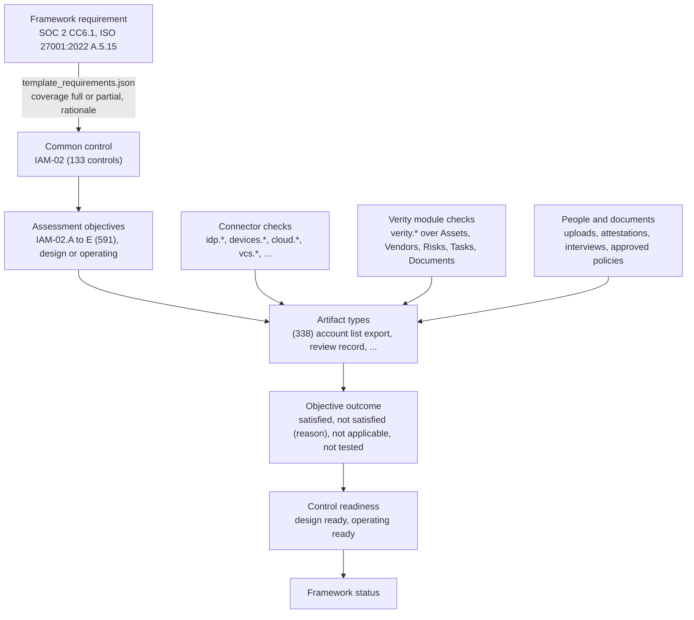
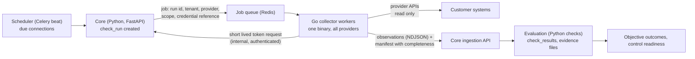

# 1. The evidence model and the collector architecture

How evidence from a connected system, from Verity's own modules and from people reaches an assessment
objective, a control and a framework; and how connectors are built so that this holds for every
provider. Authoring rules: [AUTHORING.md](AUTHORING.md).

## 1.1 The chain, as built today

| Layer | Where it lives | Notes |
|---|---|---|
| Requirement to control | `seed/content/{soc2,iso27001}/template_requirements.json` | Coverage and rationale per mapping |
| Objectives | `seed/content/objectives/objectives.json` | Verity's own words; methods name artifacts |
| Artifacts and their sources | `seed/content/objectives/artifacts.json` | `sources`: `check` (keys), `document` (template), `person` |
| Checks | `seed/content/automation/checks.json` | Written per capability, implemented per provider, mapped to controls |
| Capabilities and providers | `seed/content/automation/capabilities.json` | The integration catalogue |
| Outcome engine | `backend/src/verity/modules/objectives/outcomes.py` | Pure functions, derived, never stored |
| Runs and results | `backend/src/verity/modules/connectors/` | `connections`, `connection_resources` (scope), `check_runs`, `check_results` |

The three evidence categories of the diagram map onto the existing source kinds:

| Category | Source kind in `artifacts.json` | Example |
|---|---|---|
| Automated, from connected systems | `check` with a connector check key | `idp.mfa_enforced` from Entra ID |
| From Verity's own modules (TPRM, Assets, Risk, Vulnerabilities, Tasks, Documents) | `check` with a `verity.*` key, or `document` with a template key | `verity.vendors.assessed_in_cadence`; template `access-control-policy` |
| From people | `person` | an upload, an attestation, a reviewed interview note |

Today: 268 of the 338 artifacts list only `person`, 47 list a check and 44 a document template. The
coverage files in [coverage/](coverage/) say, artifact by artifact, which sources each one gains.

## 1.2 How an artifact and an objective are decided (the engine as built)

- An artifact is **satisfied** when any of its sources is current and accepted and none contradicts it.
  A failing check wins over everything (`deviation`). A check in `error` or `stale` gives
  `insufficient_information`.
- A person's evidence counts only once reviewed and approved (owner decision of 2026-11-23); pending
  rows give `awaiting_review`, lapsed rows `stale`. `validity_days` on the artifact sets the lapse.
- An objective is satisfied when every artifact named by its examine, test or observe methods is
  satisfied. An interview alone never satisfies.
- A control is ready when a person says it is implemented and every applicable design and operating
  objective is satisfied.
- **Automation rule (owner decision, 2026-11-23): rule B.** A passing check may satisfy its artifact
  once a person has confirmed the population is complete (rule A, kept in the engine for comparison,
  would let a check only take satisfaction away). Readiness switches to objectives only after the
  independent review and the owner's sign off on the comparison report. This plan asks one refinement
  (decision G1): a check that fills an artifact only `partial` should not satisfy it alone, only one
  that fills it `full`.

## 1.3 Rules every new source follows

1. **The person source stays.** Adding a check never removes `person` from an artifact. A company
   without the system, or with an unsupported one, can always provide the same artifact by hand.
2. **A check fills an artifact `full` only when it collects the artifact itself** (the account list,
   the branch protection settings) for the whole in scope population. Otherwise it is `partial`, and the
   engine treats it under rule A.
3. **Population before predicate.** Each check first proves it saw the whole population (every user,
   every device, every in scope repository). Truncated paging, a missing permission or an unscoped
   account gives `insufficient_information`, never a pass on what was seen.
4. **Empty is not proof.** Zero merges does not show there were no direct pushes. A check that can
   legitimately see an empty population says how it knows (for example the provider's own counter).
5. **Period evidence.** For an operating objective over a SOC 2 Type 2 window, the daily results are
   the history. A gap in runs is visible on the control and in the export. Look back windows of the
   provider (30 days of sign in logs in Entra ID P1, 90 days of Okta System Log) are recorded on the
   check, so nobody relies on data the provider no longer holds.
6. **Scope is explicit.** Resources are listed into `connection_resources`; archived, forks, test
   tenants or personal devices are out only with a recorded reason (system or person).
7. **Coverage is per mapping, not per connector.** A connector "covering" a control means nothing; a
   check mapped `full` or `partial` to a control, with its rationale, does.

## 1.4 Observations: the contract between collectors and checks

Checks are written per capability, so one predicate must work for every provider of that capability.
That only holds if every collector hands over the same shape. Collectors therefore **normalise** what
they read into observation types, and checks evaluate observations, never raw API answers.

| Observation type | Capability | Main fields (normalised) |
|---|---|---|
| `identity.user` | identity_provider | id, email, display name, status (active, suspended, deprovisioned), kind (member, guest, service), is admin, admin roles, MFA enrolled, MFA methods, last sign in, created, deactivated |
| `identity.policy` | identity_provider | kind (sign in, MFA, password, session), target (all users, groups), enforced, settings |
| `identity.app` | identity_provider | id, name, SSO protocol, assignment required, users or groups assigned, consented scopes |
| `identity.event` | identity_provider | sign in and admin events needed by a check (type, actor, target, time) |
| `vault.member` | password_manager | id, email, state, invited, joined |
| `device` | device_management, endpoint_protection | id, serial, owner email, ownership, OS and version, encrypted, screen lock seconds, firewall, protection agent, last seen, managed |
| `person.record` | hr_system | id, email, status, start date, end date, manager, employment type |
| `repository`, `branch_rule`, `change`, `review`, `pipeline_run`, `deployment` | version_control, ci_cd | as the GitHub connector already keeps them |
| `cloud.resource` | cloud_infrastructure, asset_discovery | provider, account, region, type, id, tags, and per type settings (encryption, public access, rules) |
| `cloud.principal`, `cloud.credential` | cloud_infrastructure | identity, attached policies, key ages, MFA |
| `ticket`, `alert`, `incident`, `monitor` | ticketing, alerting, observability | ids, type, status, timestamps, links, owner |
| `edge.zone`, `edge.policy` | network_edge | settings that checks read |

Every observation also carries: tenant, connection, provider, resource scope state, `observed_at`, the
API source (so an auditor can retrace it), and the run's **completeness** per type (`complete`,
`truncated`, `permission_missing`, `unsupported_by_plan`). The schemas are versioned JSON Schema files
(proposed: `contracts/observations/*.schema.json`), from which the Go structs and the Python models
are generated, so the two sides cannot drift.

## 1.5 Collector architecture (Go)

Collectors may be written in Go. The split below lets them be, without moving any rule that the
platform relies on.

| Concern | Decision |
|---|---|
| Where code runs | Go collectors are stateless workers. They never open the database. Everything they produce enters through the core's ingestion API, which binds the tenant in the transaction, so row level security stays the wall (CLAUDE.md rules 1 and 2). |
| Credentials | Stored envelope encrypted by the core (existing `connections.credential_ciphertext`, `APP_ENCRYPTION_KEY`). A collector asks the core for a short lived access token for its run (the core refreshes OAuth tokens); long lived secrets never leave the core. Vendor side secrets (Verity's own multi tenant app certificate, its AWS identity for assuming customer roles) live in the runtime's secret store, never in the database. Nothing secret is logged (rule 8). |
| What a collector does | Authenticate, list resources, page through, respect rate limits, normalise into observation types, report completeness per type. No pass or fail logic. |
| What the core does | Scheduling, scope (`connection_resources`), evaluation of checks (one predicate per capability), results, evidence files, audit rows, outcome engine. |
| Idempotency | A job carries the run id. A retried job replaces its own observations; a late job for a superseded run is dropped. One active run per connection. |
| Rate limits | Per provider limiter in the Go runtime, honouring `Retry-After` and provider specific headers; bounded retries with backoff; a run that cannot finish records `truncated` rather than waiting forever. |
| Layout | A Go module `collectors/`: `cmd/collector`, `internal/runtime` (job loop, retries, limiter, paging helpers, telemetry), `internal/contracts` (generated from the JSON Schemas), `providers/<name>` (auth, fetch, normalise), `fixtures/<name>` (recorded HTTP, for example with go-vcr). |
| Testing | Recorded fixtures per provider in CI, never a live customer account; a contract test that every provider's output validates against the schemas; a parity test when a Python collector is ported. |
| Telemetry | Per run: duration, API calls, throttles, completeness, error classes; surfaced on the connection's health. |
| Migration | The GitHub collector stays in Python until the Go runtime has run one provider in production. Then GitHub is ported with a parity test on recorded fixtures. New providers start in Go. |

Why not let Go evaluate too: checks are content mapped to controls, versioned with the objectives and
reviewed with them. Keeping evaluation in one place keeps one meaning per check key across providers,
keeps the outcome engine pure, and lets a check change without redeploying collectors.

## 1.6 What changes in content when a connector ships

1. `capabilities.json`: the provider's status goes from `planned` to `available` (plus the provider
   fields of [02-integration-model.md](02-integration-model.md)).
2. `checks.json`: the provider is added to `implementations` of each check it supports; new checks are
   added with their control mappings.
3. `artifacts.json`: artifacts named in the coverage files gain the check as a source (the `person`
   source stays).
4. The check catalogue is regenerated (`backend/scripts/build_check_catalogue.py`) and content is
   resealed (`scripts/seal_content.py`).
5. The comparison report of the outcome engine (rule A and B) is reviewed before release, so the owner
   sees which controls change readiness because of the new source.

## 1.7 Production readiness

The gates in `docs/product/continuous-compliance-plan.md` section 9 apply to every connector. The
connector acceptance contract in its section 7 is the definition of done for each provider in
[04-phases-and-work-packages.md](04-phases-and-work-packages.md).
