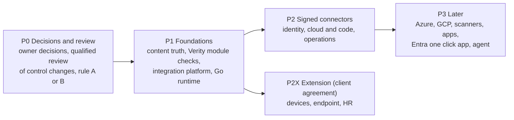

# 4. Phases and work packages: how this plan gets built

The execution plan. An agent or developer picks one work package, reads what it lists, builds it,
proves it, and ticks it in `openspec/changes/evidence-connectors-program/tasks.md`. Nothing here is
built yet. Numbers come from the registry ([05-check-registry.md](05-check-registry.md)), the control
changes ([06-control-changes.md](06-control-changes.md)) and the matrix ([07-control-matrix.md](07-control-matrix.md)).

## 4.0 Before starting any package

1. Read `CLAUDE.md` (the twelve rules), [AUTHORING.md](AUTHORING.md), [01-evidence-model.md](01-evidence-model.md)
   and [02-integration-model.md](02-integration-model.md).
2. Read the package's sources: the connector document in [connectors/](connectors/), its verification log in
   [verification/](verification/), and the coverage files of the controls it touches in [coverage/](coverage/).
3. Check the owner decisions the package depends on ([08-owner-decisions.md](08-owner-decisions.md)). A
   package whose decision is open does not start.
4. Facts still marked "unverified" in a connector document are confirmed against the provider (a
   developer or trial account) before code depends on them.

## 4.1 Phase map

| Phase | Packages | Gate to start |
|---|---|---|
| P0 | D1 owner decisions; D2 qualified review of control changes and mappings; D3 automation rule A or B | none |
| P1 | F1 to F8 below | D1 for the decisions each package names; D2 before F2 ships |
| P2 | C1 to C14 below | F4 and F5 (platform and runtime); F1 for the content each connector fills |
| P2X | X1 to X8 below | The client agrees to the extension (devices, endpoint and HR are not in the signed catalogue) |
| P3 | L1 to L6 below | Demand or the signed Phase 3; F7 before any scanner |

## 4.2 P1 Foundations

| Package | What | Main sources | Done when |
|---|---|---|---|
| **F1 Content truth** | Fix the defects found: split `inventory-of-company-devices` and give each part a person source; merge duplicate artifacts; add the template source to document artifacts that lack it; apply the coverage downgrades (full to partial); the template gaps (code of conduct acknowledgement, access control policy MFA wording and password length, HR recheck interval, officer appointment, incident customer notice, supplier DPA and breach terms). Content edits, resealed; data migration where tenants hold copies. | 06-control-changes.md (defects), 05-check-registry.md (downgrades), coverage/*.md | `seal_content.py --check` passes; the outcome engine comparison report shows every control whose readiness changes, and the owner accepts it |
| **F2 Control breakdown** | Apply the approved splits, adds and objective revisions family by family (GOV, CS, HR; IAM, EP, PE, NS, DM; SD, LM, BC): new control templates, moved and new objectives and artifacts, mapping diffs, adoption proposals for existing workspaces (never copying a green result or a risk acceptance to a successor) | 06-control-changes.md, coverage/*.controls.json | Each family's changes reviewed (D2), migrated up and down on `verity_test`, adoption proposal visible to a workspace admin, audit rows written |
| **F3 Verity module evidence** | Build the proposed `verity.*` checks (Verity's own modules as evidence) and the module gaps they need: an incident marker and customer notice field in Tasks; scan targets recorded on vulnerability imports; a triage time setting; a device type in Assets; the company's subprocessor list (distinct from vendors' own suppliers); a staff roster CSV import as the first HR source; Verity's own Keycloak sign in and directory sync as evidence (`verity_identity`); the device attestation flow (mdm-and-endpoint-strategy.md 7.5) | 05-check-registry.md (verity section), coverage/*.json entries with phase P1 | Every P1 artifact in the coverage files has a working source; checks have unit tests on fixtures and an integration test on `verity_test` |
| **F4 Integration platform** | Provider content (02 section 2.5); the catalogue generated from content instead of `connector-catalogue.ts`; the connect dialog generated per credential pattern; before you connect screen; permission probe per check; health page; scope dialog for every resource type; credential expiry reminders; setup guides as content in a side panel; the integration card that joins single sign on and evidence (`tenant_sso.connection_id`) | 02-integration-model.md | GitHub runs through the new dialog and catalogue with no behaviour change; a second provider needs content only for its screens |
| **F5 Go collector runtime** | `collectors/` Go module, observation JSON Schemas and generated structs and models, the job queue contract, the core's ingestion API (tenant bound, row level security intact), short lived token endpoint, rate limiter, recorded fixture harness, telemetry; deploy as a container beside the worker | 01-evidence-model.md 1.4 and 1.5 | One provider (the first of C1) runs end to end in staging from schedule to objective outcome; contract tests pass; a tenant isolation test proves a job for tenant A cannot write observations for tenant B |
| **F6 GitHub fixes** | The built gap: direct pushes to the default branch are not seen, so review checks can pass after a bypass (fix before any customer relies on SD-06); the GitHub App decision; CI checks | connectors/github.md | The bypass case is a failing test that now passes; downgrades applied |
| **F7 Vulnerability module before scanners** | Match findings to assets by stable identifiers, keep unmatched findings visible, start the SLA clock at the scanner's first seen date, map each scanner's severity scale faithfully, let a rescan close a finding | connectors/phase3-catalogue.md (scanner section) | No finding from an import can be lost or made less severe; a fixture rescan closes a fixed finding |
| **F8 Vendor side setup** | Verity's own identities: a cloud identity to assume customers' AWS roles (Roles Anywhere or a key, decision), a key service that can sign without exporting keys, a Google Cloud project and service account for domain wide delegation, the Microsoft partner account for later publisher verification | connectors/aws.md, google-workspace.md, identity-providers-unified-setup.md | Credentials live outside the database, rotation documented in a runbook |

## 4.3 P2 Signed connectors (contract Phase 2)

Order follows value to the controls and the pilot customer's systems (continuous-compliance-plan.md
section 7). The first identity provider is the pilot's; the others follow.

| Package | Connector | Notes |
|---|---|---|
| C1 | Entra ID and Microsoft 365 | Two credential wizard (sign in plus evidence, Verity generated certificate); MFA registration report needs P1 or P2; sign in logs 7 days on Free, 30 on P1 or P2 |
| C2 | Google Workspace | Domain wide delegation to Verity's service account; apply Google's defaults where the Policy API returns nothing |
| C3 | Okta | API Services app with private key JWT; admin role per decision (custom role with read scopes is an option) |
| C4 | 1Password | Membership and vault evidence; SCIM bridge token decision |
| C5 | AWS | Custom least privilege policy, CloudFormation one click role, Organizations for many accounts |
| C6 | GitHub expansion | After F6: GitHub App if decided, CI and deployment checks, secret and dependency alert timeliness |
| C7 | GitLab | Tier differences recorded per check (several need Premium or Ultimate) |
| C8 | Bitbucket | Branch restrictions need an admin scope (decision); no deployment protection API |
| C9 | Jira | Scoped service account token first (shared OAuth quota); tell automation transitions from human approvals |
| C10 | PagerDuty | On call coverage, acknowledgement and resolution times; incidents into the incident register (decision) |
| C11 | Datadog | Monitors on production, log retention, Cloud SIEM rules and signals |
| C12 | Sentry | Alert rules, error triage timeliness |
| C13 | Cloudflare | WAF, TLS, HSTS, DNSSEC, Zero Trust Access |
| C14 | Tailscale and Slack | Tailscale access policy, device approval and key expiry; Slack for notification delivery only |

## 4.4 P2X Extension (needs the client's agreement)

| Package | What |
|---|---|
| X1 | Intune and Defender for Endpoint on the Entra evidence app (one more consent) |
| X2 | Google devices and Endpoint Verification on the Google Workspace connection |
| X3 | Jamf Pro |
| X4 | Kandji |
| X5 | CrowdStrike Falcon |
| X6 | SentinelOne (when a partner console gives access to its API reference) |
| X7 | HR systems: BambooHR, HiBob, Rippling, then Gusto (partner review), Workday on demand |
| X8 | Learning platform, e-signature and background screening capabilities, if the owner adds them |

## 4.5 P3 Later

| Package | What |
|---|---|
| L1 | Azure and GCP (Verity token issuer shared with Azure for keyless sign in) |
| L2 | Vulnerability scanners: Tenable, Rapid7, Qualys (after F7) |
| L3 | Business applications and AI providers (needs the read only key ADR for providers without one) |
| L4 | The rest of the Phase 3 catalogue, on demand |
| L5 | Verity's own multi tenant Entra evidence app (one click consent), after the first Entra pilot |
| L6 | Re-decide the Verity endpoint agent (Go and osquery) when customers without an MDM or Google Workspace are a meaningful share |

## 4.6 Definition of done for a connector package

A connector is done only when every line holds:

1. **Content.** The provider entry (02 section 2.5) with permissions, fields, requirements and docs
   links; the provider added to `implementations` of each check it supports; new checks added with
   control mappings and rationale; artifacts gain the check as a source (the person source stays);
   catalogue regenerated; content resealed.
2. **Collector.** Go provider: auth, paging, rate limits, normalisation into the observation types,
   completeness per type, error classes; recorded fixtures for every API used, including permission
   missing, empty, truncated and plan limited answers.
3. **Checks.** Each predicate implemented once per capability in the core and tested on normalised
   fixtures for pass, fail, error and insufficient information, including the empty population case.
4. **Product.** The connect screen from content, the setup guide with its last checked date, the
   permission probe, scope selection, health states, disconnect with history kept.
5. **Proof.** A run against a real developer or trial account of the provider, with the results
   compared by hand to the provider's console; the outcome engine comparison report reviewed; the
   connector acceptance contract of `continuous-compliance-plan.md` section 7 ticked line by line.
6. **Docs.** The connector document updated from plan to as built; STATE and CHANGELOG in local-context;
   the handoff branch pushed.

## 4.7 Definition of done for a control family package

1. Every objective of every control in the family has, for each artifact its methods name, at least one
   source a customer can actually provide today (a person source at minimum).
2. Every automated source named for the family is either built or listed as planned with its phase on
   the control page; nothing shows as automated that is not.
3. Every mapping of the family's controls to SOC 2 and ISO 27001 has its coverage and rationale reviewed
   (D2), with partial mappings never reading as met alone.
4. The control page guidance walks the objectives in order and links each unsatisfied one to its next
   action (start the document, upload the record, connect the source, assign the owner).
5. Tests: content loader tests, outcome engine tests for the family's controls, and the comparison
   report reviewed.

## 4.8 Tracking

- `openspec/changes/evidence-connectors-program/tasks.md` holds one checkbox per package above.
- The coverage JSON files are the source for the matrix: when a source ships, its entry moves from
  planned to built, and `07-control-matrix.md` is regenerated.
- Every session that changes anything here updates `local-context/STATE.md` and `CHANGELOG.md`, and
  pushes the GitHub branch `handoff/verity-dev`.
