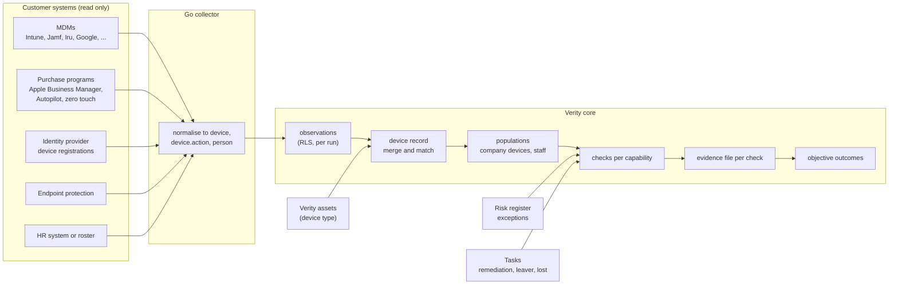
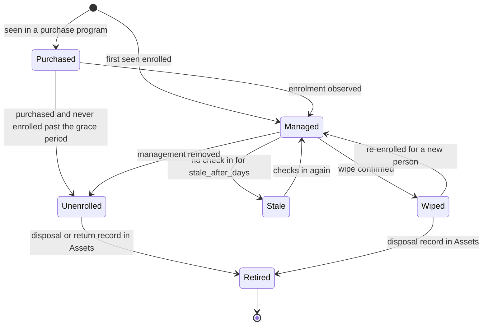
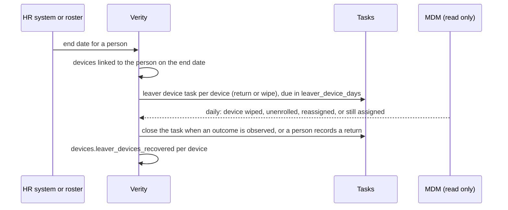

# 5. The device evidence process, end to end

How device evidence flows from a customer's MDM to an objective outcome, and every process around it:
connecting, scoping, matching devices to people, judging each platform fairly, history, exceptions, leavers,
lost devices, retirement, the auditor's view and the screens. Provider facts are in
[03-provider-field-maps.md](03-provider-field-maps.md); device types in [01-device-landscape.md](01-device-landscape.md);
checks in [04-checks-and-control-mapping.md](04-checks-and-control-mapping.md).

## 5.1 The flow in one picture

The collector reads and normalises only. Matching, populations and every pass or fail decision happen in the
core, once per capability, whatever the provider (ADR-0016).

## 5.2 Connecting a device source

| Step | What the customer does | What Verity does | Screen |
|---|---|---|---|
| 1. Choose | picks the MDM from the catalogue; can connect more than one (Mac fleet on Jamf, Windows on Intune) | shows the before you connect page: what is read, what is never read, the permission, the plan or licence needed | catalogue, before you connect |
| 2. Credential | creates the read only credential from the setup guide (per provider, with screenshots and a last checked date) | stores it envelope encrypted; never in logs | connect dialog with guide panel |
| 3. Test | presses Test | runs a `probe` job: one call per permission, reports per check "ready", "missing permission", "plan does not include it" | test results |
| 4. Scope | chooses platforms, groups or sites, and whether personal devices are in scope (tenant setting D-MDM-4); excludes groups only with a written reason | stores scope; an exclusion becomes a visible line in every evidence file | scope dialog |
| 5. First inventory | nothing | full read; builds device records; opens the matching review | matching review |
| 6. Matching review | confirms or fixes unmatched devices and people (section 5.4) | learns manual links; never guesses silently | matching review queue |
| 7. Running | nothing | daily collection (setting), checks evaluated after each run, health page shows lag and errors | control pages, health |

Rules:
- A device source never counts as connected until the Test step passed for `devices.enrolled`.
- Missing permission or licence is `error` ("could not check"), shown with the fix. Never `fail`.
- Disconnecting keeps history and evidence already filed; new runs stop; affected checks show "not connected".

## 5.3 The device record and merging sources

A customer can have the same laptop in an MDM, an EDR, the identity provider, Apple Business Manager and
Verity's asset register. Verity keeps one **device record** per physical device per workspace, built from
observations, with the source of every attribute.

### 5.3.1 Match keys, strongest first

1. Serial number plus manufacturer (normalised: upper case, trimmed, placeholder values such as
   "0", "Not available" or "To be filled by O.E.M." discarded).
2. Provider ids that link systems: Intune `azureADDeviceId` to the Entra device id and Defender
   `aadDeviceId`; Google device id across Endpoint Verification and endpoint management; an MDM's own id
   recorded on the EDR (where the EDR stores it).
3. Hardware ids for company owned phones (IMEI, MEID), when the channel exposes them.
4. Hostname plus MAC address. A match made on name alone is **weak**, labelled in the evidence, and never
   used to satisfy a completeness check.

Personal devices on privacy preserving channels (Apple User Enrolment, Android personally owned work
profile) have no serial number. They are matched by the provider's enrolment id only, and are never merged
with another source's record.

### 5.3.2 Which source wins per attribute

| Attribute | Authority, in order | Why |
|---|---|---|
| Enrolment, management state, wipe capability | the MDM that manages the device | only the manager knows |
| Encryption, lock, firewall, OS version | the managing MDM; then the EDR or agent if the MDM does not report it; never the asset register | system reported state |
| Protection agent health | the EDR connector | the EDR is the authority for its own sensor |
| Purchased, company owned | purchase program (ABM, Autopilot, zero touch), then the MDM's ownership field, then the asset register | purchase records are the population root |
| Assigned person | the MDM's primary user, confirmed against the identity provider account; a manual link in Verity overrides | the MDM is often stale; the person link is reviewed |
| Retired or disposed | Verity asset register disposal record | a business record, not a device state |

When two sources disagree on a state (Jamf says FileVault on, the EDR says off), the evidence shows both
values and the check uses the authority; a disagreement older than one run raises a data quality note on
the device, never a silent pick.

### 5.3.3 Lifecycle of a device record

Every transition is stored with the date first observed. This history is what proves "throughout the period"
(EP-02.B) and "before issue" (EP-02.C, EP-03.B); a single present tense snapshot cannot.

## 5.4 Matching devices to people

People come from the identity provider (active member accounts) and, where connected, the HR system or the
roster import, which adds start and end dates and employment type.

| Case | What Verity does | Check affected |
|---|---|---|
| Device's primary user email equals an active account | linked, strong | all person checks |
| Email differs only by alias or domain the workspace owns | linked, shown as alias match; one click to confirm | same |
| No user on the device | listed in the matching review: assign, mark shared or dedicated (with a reason), or mark spare stock | `devices.assigned_to_active_staff` fails until resolved, except shared, dedicated and spare with reasons |
| User is suspended or deleted in the identity provider | device stays linked to that account; fails `devices.assigned_to_active_staff`; starts the leaver flow if the person has an end date | leaver checks |
| Active person with no managed device | listed: assign a device, or record "no company device" with a reason (for example warehouse staff using a shared kiosk) | `devices.staff_have_managed_device` |
| Contractor on own laptop | covered by the personal device policy (D-MDM-4): either enrolled on a BYOD channel, or excluded with the reason "company data reached through app protection or VDI only" | same |

Exclusions and manual links are audited (actor, time, reason) and printed in every evidence file that relies
on them.

## 5.5 Populations

Completeness is the hardest part of device evidence: an MDM cannot see a laptop that never enrolled.
Verity builds two populations and compares each with the managed list.

- **Company devices** = union of: purchase program lists (ABM organisation devices, Autopilot device
  identities, zero touch or Knox devices), MDM records marked company owned, Verity asset register
  devices, identity provider devices joined to the directory (Entra joined, Google company owned).
  Minus retired with a disposal record. A purchased device not enrolled after `enrol_grace_days`
  (setting, default 7) fails `devices.purchased_devices_enrolled`.
- **People who need a device** = active staff from the identity provider (members, not guests or service
  accounts), refined by HR employment type when connected, minus people recorded as "no company device".

When no purchase program and no asset register devices exist, the company device population is only what the
MDM knows. The evidence then says so in plain words ("population taken from the MDM only; devices that never
enrolled cannot be seen"), and the enrolment check's coverage of EP-03.B stays partial. The person side check
(`devices.staff_have_managed_device`) is then the only route to unmanaged laptops, which is why it matters.

## 5.6 Judging each platform fairly

A check is one predicate per capability, but what counts as "encrypted", "locked" or "current" differs by
platform. The per platform predicates are in [01-device-landscape.md](01-device-landscape.md) 1.5 and live in
the check content, never in collector code. Three rules from the research matter most for the process:

- **Screen lock is policy evidence everywhere** except Shared iPad: no platform reports the device's live idle
  time. Verity proves the enforced policy is installed and within the limit, with a separate mobile limit.
- **Wipe possible** depends on the channel, not on supervision: any Apple channel except User Enrolment can
  erase; Android personal work profiles and Apple User Enrolment only remove company data.
- **Wipe done** needs a later signal: an erase reply alone never confirms the outcome on Apple devices
  ([02](02-what-verity-collects.md) 2.4, `confirmed_by`).

A platform the source cannot answer for gives `insufficient` for that device, with the reason, never `pass`.

## 5.7 Freshness, period and history

- **Collection**: daily by default (setting); after a connection change, a full run. A run that did not page
  to the end of a population gives `insufficient` for every check of that run (AUTHORING rule 3).
- **Stale devices**: no check in for `stale_after_days` (default 14): state checks give `insufficient` for
  that device (its state is unknown); `devices.enrolled` gives `fail` for it (out of contact is the fact).
- **Period checks**: "throughout the period" is judged on the stored daily device history. A gap in
  Verity's own runs longer than `history_gap_days` (default 3) is printed in the evidence as a gap, and the
  objective outcome for that window is `insufficient`, never assumed.
- **Before Verity was connected**: providers mostly expose present state only (see 03). Verity says so;
  for the period before connection, the objective needs people evidence (an MDM export from that time).
- **Retention**: device history is kept as long as the workspace's evidence retention (default the audit
  period plus one year); raw provider payloads are not kept beyond the run's batch file in object storage.

## 5.8 Exceptions

A device that fails and cannot be fixed (a lab machine, a legacy OS for a customer integration) is handled
through the risk register, not by excluding it from scope.

1. The device owner or IT lead raises an exception from the failing device row: device, control, reason,
   compensating safeguard, approver, expiry (maximum `exception_max_days`, default 180).
2. Approval is by a person other than the requester (segregation of duties, as for risk acceptance).
3. While in force, the device shows "failing, exception in force". **Engine change (proposed, D-MDM-6):**
   today a failing check result is a deviation that wins over every other source (01-evidence-model 1.2),
   so one excepted laptop would hold EP-02.B in deviation all year. The proposal is a per resource waiver:
   a check run lists each failing resource with any exception in force that names it; the run's result is
   `pass` when every failing resource has one, and the evidence lists them under "failing, exception in
   force". The exception itself is evidenced separately (EP-02.D), so the waiver never hides a decision.
4. On expiry the device fails again and a task goes to the owner. `verity.exceptions.in_force` evidences
   EP-02.D and the exception parts of EP-01.B and EP-04.D.

## 5.9 Leavers

Verity never sends the wipe. The customer's IT issues it in the MDM; Verity observes the outcome. A device
returned, put in a drawer and later re-enrolled is evidenced by a person recording the return (with date) in
the task; the MDM shows the later re-enrolment.

Signals that close a leaver device task, strongest first: a wipe with `confirmed_by` later_signal (no contact
after the command and a re-enrolment of the same serial; Apple Business `deviceEraseStatus` ERASED, only for
devices under its built in management; Rippling `FULL_WIPED`); a reassignment to an active person observed in the MDM; a recorded return (Rippling warehouse
return order, or a person's entry in the task). Two gotchas: retiring an Entra joined laptop suspends BitLocker,
so its last report can read unencrypted (record the retire first) [ms G12]; a user linked Activation Lock
can block reuse of a returned Apple device, which `devices.activation_lock_org_controlled` catches early.

## 5.10 Lost or stolen devices

1. Staff report a loss through a Tasks template ("Lost or stolen device"), which records device, time and
   circumstances.
2. IT issues lost mode or a wipe in the MDM.
3. Verity observes the command and its completion (`device.action`) and links it to the task.
4. If the device never reconnects, the task asks IT to record the credentials rotated (EP-05.E); this stays
   people evidence.
5. `devices.wipes_confirmed` evidences EP-05.D; the task register evidences EP-05.C.

## 5.11 Retirement and disposal

A device that leaves management (unenrolled, removed, deleted from the MDM) must end with a record in Verity
Assets: reissued to someone, returned to stock, sold, recycled or destroyed, with method and certificate
where a contractor handled it. `devices.removed_have_disposal_record` evidences EP-08.B for devices.
This needs the device type in Assets (D-DEV-6, recommended yes).

## 5.12 What the auditor gets

For each device check and each run: one evidence file (as built for GitHub) with the scope and exclusions,
the population and where it came from, per device results with the attribute values and their sources, weak
matches flagged, exceptions in force, and the run's completeness. On top of that, for the audit period:

- **Population export**: every company device and every person in the period, with first and last seen,
  so the auditor can pick a sample.
- **Sample view**: for a chosen sample, each device's daily history through the period.
- **Gaps report**: days without a run, devices stale for part of the period, sources disconnected.

The export is CSV and PDF, timestamped and hashed like other evidence files.

## 5.13 Screens

| Screen | Where | What it shows |
|---|---|---|
| Devices register | Assets, filtered to devices (or a Devices tab if Assets keeps no device type) | one row per device record: person, platform, ownership, channel, sources, last check in, and a pass or fail chip per check |
| Device detail | from the register | attributes with their source and date, history timeline, linked tasks and exceptions |
| Person view | from a member | devices held, gaps ("no managed device"), leaver tasks |
| Matching review | after the first run and when new gaps appear | unmatched devices and people, with one click fixes and a reason box |
| Connection card | Integrations | one card per provider joining sign in and evidence where the provider does both (Entra, Google, Okta); health per capability |
| Control pages | EP-01 to EP-08, DM-19, HR-05, LM-01 | each objective with its device checks, results and next action |

UI copy follows the house rules: short, no visible dashes, focused decisions in popups.

## 5.14 Settings (defaults are drafts for the owner, D-MDM-8)

| Setting | Default | Used by |
|---|---|---|
| `collection_interval_hours` | 24 | runs |
| `stale_after_days` | 14 | all state checks |
| `enrol_grace_days` | 7 | `devices.purchased_devices_enrolled` |
| `max_idle_lock_minutes` | 15 (objective parameter of EP-06) | `devices.screen_lock` (computers) |
| `max_idle_lock_minutes_mobile` | 2 (CIS 4.3; D-MDM-9) | `devices.screen_lock` (phones, tablets) |
| `directory_active_days` | 30 (at least 21: Entra activity moves in 14 day steps) | `devices.directory_devices_managed` |
| `drift_fix_days` | 14 | `devices.drift_fixed_in_time` |
| `browser_max_age_days` | 30 | `devices.browsers_current` |
| `software_fix_days` | 14 | `devices.software_permitted` |
| `disposal_record_days` | 30 | `devices.removed_have_disposal_record` |
| `os_minimums` | per platform, maintained by Verity, overridable | `devices.os_current` |
| `android_patch_max_age_days` | 90 | `devices.os_current` (Android) |
| `leaver_device_days` | 7 | `devices.leaver_devices_recovered` |
| `wipe_pending_max_days` | 7 | `devices.wipes_confirmed` |
| `history_gap_days` | 3 | period checks |
| `exception_max_days` | 180 | exceptions |
| `personal_devices` | in scope when they reach company data | populations |
