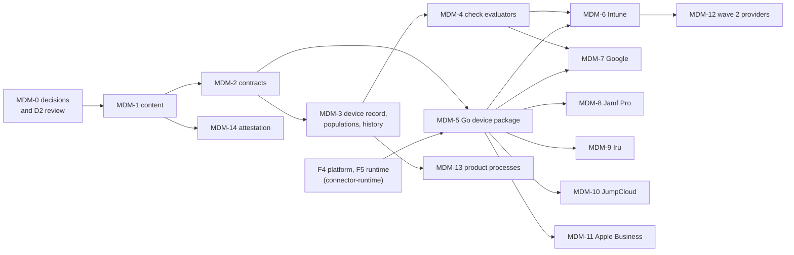

# 6. Build plan: work packages for agents and developers

Nothing here is built. Each package names what it builds, what to read first, what it depends on and what
proves it done. Tick packages in `openspec/changes/mdm-device-evidence/tasks.md`. The general rules of
[../04-phases-and-work-packages.md](../04-phases-and-work-packages.md) 4.0, 4.6 and 4.7 apply to every package.

## 6.0 Gates

1. **Scope.** Device management is not in the signed catalogue and the delivery plan lists a device agent
   as out of scope. D-DEV-1 (bring device evidence in as an extension the client agrees) must be decided
   before any provider package starts. Content packages MDM-1 and the attestation flow MDM-14 can start
   without it, because they help customers without any connector.
2. **Runtime.** Provider packages need the connection platform and the Go runtime (F4, F5 in
   `openspec/changes/connector-runtime/`).
3. **Review.** Content changes (04 4.7) need the qualified review D2 before they ship.

## 6.1 Order

Wave 1 order follows [market 9 item 1]: Intune (with Defender, X1), Google devices (X2), Jamf Pro (X3),
Iru (X4), JumpCloud (new), with Apple Business as the purchase source beside the Apple MDMs. Wave 2 on demand:
Workspace ONE, ManageEngine, Rippling devices, Addigy, SimpleMDM, Fleet, NinjaOne, Device Trust. Not buildable
today: Hexnode (no read only key), Mosyle (no public reference).

## 6.2 Packages

| Package | What | Read first | Depends on | Done when |
|---|---|---|---|---|
| **MDM-0 Decisions and review** | Owner answers [07-decisions.md](07-decisions.md); D2 reviews content changes CC1 to CC7 (04 4.7) and the 28 check mappings | 07, 04 | none | decisions recorded in 07 with date; D2 sign off per control family |
| **MDM-1 Content** | Artifact split (F1) plus `device-baseline-report`, `permitted-software-report`, `personal-device-access-report`; every device artifact keeps `person`; objective EP-03.F and `max_idle_lock_minutes_mobile`; 28 checks in `checks.json` with mappings, rationales and `implementations`; capability providers (CC7); reseal | 04, `../AUTHORING.md`, `../01-evidence-model.md` | MDM-0 (D2) | `seal_content.py --check` passes; content loader tests; the outcome engine comparison report lists every readiness change and the owner accepts it; data migration where tenants hold copies |
| **MDM-2 Contracts** | JSON Schemas `device` v2, `device.policy`, `device.purchase`, `device.action`, `device.app_protection`, `device.directory` (02); generated Go structs and Python models; CI fails on stale generation | 02, connector-runtime design 1, 3 | connector-runtime task 1.1 | schemas versioned; a field added without regeneration fails CI |
| **MDM-3 Device record, populations, history** | Core service: merge observations into one device record per device (05 5.3: match keys, authority per attribute, conflicts noted), the two populations (05 5.5), daily device state history with gap detection (05 5.7), manual links and exclusions with audit rows; Assets device type if D-DEV-6 is yes (migration with RLS, CHECK constraint, downgrade) | 05, `modules/assets`, CLAUDE rules 1 to 6 | MDM-2 | integration tests on `verity_test`: two sources for one laptop give one record with both values shown; a weak name match never satisfies completeness; isolation test across tenants; migration up, down, up |
| **MDM-4 Check evaluators** | The 28 predicates per platform (01 1.5, 04 4.2 and 4.3) over observations; evidence files with IPE metadata (04 4.1); per resource exception waiver if D-MDM-6 is yes | 04, 01, `../01-evidence-model.md` 1.2 | MDM-3, MDM-1 | per check unit tests on normalised fixtures for pass, fail, error, insufficient, `not_applicable`, empty population, stale device, policy not installed, exception in force; evidence file snapshot tests |
| **MDM-5 Go device package** | Shared code in `collectors/internal/devices`: normaliser to the dictionary, privacy drop (02 2.5) before any output, endpoint allowlist and field allowlist per provider, `reporting_gaps`, `inventory_reported_at`, completeness per type, a credential self check that flags `credential_reads_secrets` | 02, connector-runtime design 5 | F5, MDM-2 | fixture tests: a personal device fixture loses every never stored field; a secrets fixture (FileVault key, BitLocker key, bypass code, location) never reaches an observation; truncated paging gives `truncated` |
| **MDM-6 Intune** | Provider on the Entra evidence app (shared consent with the identity connector): managed devices, per setting compliance states, BitLocker metadata, Windows protection state, detected apps, remote action audits, Autopilot identities (purchase source), Entra devices (`device.directory`), MAM registrations, Data Warehouse 60 day backfill at connect | research/microsoft-intune.md, connectors/intune.md | MDM-5, MDM-4, X1 scope | a developer tenant run compared by hand with the Intune console; permission probe per check; a Read only token accepted by the report actions (recorded test); never selected fields absent from every request |
| **MDM-7 Google devices** | On the Google Workspace connection: Cloud Identity devices and device users, Endpoint Verification attributes, ChromeOS devices (read only role), Chrome Policy for lock delay, Chrome browsers, Knox and ChromeOS pre provisioned as purchase sources; mobile audit events for history | research/android-chromeos-google.md, connectors/google-endpoint-management.md | MDM-5, MDM-4, X2 scope | trial domain run; field masks exclude network and file fields; Android 12 personal work profile fixture matched by enterprise specific id only |
| **MDM-8 Jamf Pro** | Version ladder, computers and mobile inventory, DDM status items, configuration profiles (lock and media payloads), MDM command history | research/apple-mdms.md 4, connectors/jamf-pro.md | MDM-5, MDM-4, X3 scope | trial run on two Jamf versions (v3 and v4 fixtures); LENIENT handling; lost mode location dropped |
| **MDM-9 Iru** | Device list and details, Prism categories (FileVault, firewall, startup settings, apps), library item status, audit events; rate limit backoff | research/apple-mdms.md 5, connectors/kandji.md | MDM-5, MDM-4, X4 scope | trial run; a 403 on cellular and lost mode routes is treated as the desired state |
| **MDM-10 JumpCloud** | Systems, System Insights tables, MDM status, users (as a directory for person checks), Directory Insights when licensed | research/cross-platform-mdms-a.md B | MDM-5, MDM-4, scope extension | free tier run; person checks pass without a separate identity provider; 90 day Insights retention recorded on the check |
| **MDM-11 Apple Business** | Purchase source: organisation devices, assigned MDM server, Activation Lock status; short lived client assertion per run; never webhooks | research/apple-platforms.md 4.2 | MDM-5, MDM-3 | a purchased but unassigned device fixture fails `devices.purchased_devices_enrolled`; the private key is envelope encrypted and never logged |
| **MDM-12 Wave 2 providers** | One package per provider on demand: Workspace ONE, ManageEngine, Rippling devices (with the HR connector), Addigy, SimpleMDM, Fleet, NinjaOne, Device Trust | the provider's research section and 03 3.3 | MDM-5, MDM-4 | per package: the connector definition of done (`../04-phases-and-work-packages.md` 4.6), plus the provider's secrets refusal rule (for example refuse a SimpleMDM key with Device Secrets) |
| **MDM-13 Product processes** | Devices register and device detail, person view, matching review queue, exception from a failing device row, leaver device tasks (05 5.9), lost or stolen device task template (05 5.10), disposal link on unenrolment (05 5.11), auditor exports (population, sample history, gaps), before you connect pages, setup guides as content, privacy pack download | 05, `docs/product/` UI conventions | MDM-3, MDM-4 | browser checks on the demo stack; UI copy follows the house rules (short, no visible dashes, popups for decisions); every manual link and exclusion writes an audit row |
| **MDM-14 Attestation flow** | Round 1 7.5: per device owner, serial, OS, ownership; quarterly answers with the evidence Verity names per OS; reviewer approval fills the split device artifacts as person evidence | `../mdm-and-endpoint-strategy.md` 7.5 | MDM-1 | a workspace without any MDM can satisfy every device artifact through approved attestations; overdue attestations show on the control |

## 6.3 Testing rules for device work

- **Fixtures per provider**: complete fleet, empty fleet, truncated paging, permission missing, plan
  limited, personal device, secrets present, stale device, policy scoped but not installed, mixed platforms.
- **Platform fixtures** for every row of 01 1.5, including Android "default key", iOS without passcode,
  Cloud PC, AVD multi session, Mac with FileVault encrypting, Apple erase replied Error with a later
  re-enrolment.
- **Isolation**: a run for tenant A cannot write device observations or records for tenant B
  (`tests/isolation/`, with the app role).
- **Never long suites** in an agent session: run the targeted tests; the full suite is run by the owner.
- **Live proof** per provider: a developer or trial account, results compared by hand with the provider's
  console, recorded in the connector document (from plan to as built).

## 6.4 Definition of done for the device programme

- Every device artifact has at least one source a customer without any connector can provide (attestation).
- Every device check reaches an artifact, and every artifact names what it tests.
- Wave 1 providers pass their live proof; their check support matches 03 3.2 or the table is corrected.
- The auditor export answers: population, sample history for any day in the period, gaps.
- The privacy tests pass for every provider, and the customer privacy pack is downloadable.
- `local-context/STATE.md` and `CHANGELOG.md` updated; the GitHub branch `handoff/verity-dev` pushed.
