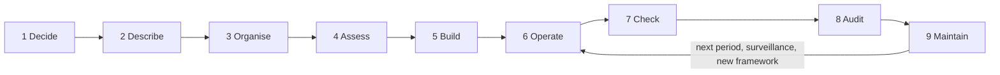

# The compliance journey: SOC 1, SOC 2 and ISO 27001, from first decision to the year after

Part 1 of the guided onboarding plan. Read [README.md](README.md) first.

This part is the subject matter the product has to follow. It says what each framework officially
asks for, in what order, who does each step, and what an organisation must decide or hand over
before any control work starts. Parts 2 to 5 turn it into requirements, screens and content.

How to read the labels:

- **OFFICIAL** means the step comes from the standard or the professional rules.
- **PRACTICE** means it is what audit firms and consultants normally do. It is common, not required.
- Standards are described in Verity's own words. No standard text is quoted.

Sources and their limits are in section 14.

## 1. Which report or certificate, and in what order

### 1.1 The three in one table

| | SOC 1 | SOC 2 | ISO/IEC 27001:2022 |
|---|---|---|---|
| What it is | An examination report on controls at a service organisation that matter to its customers' financial statements | An examination report on controls relevant to security, availability, processing integrity, confidentiality or privacy | A certificate that an information security management system meets the standard |
| Who issues it | A licensed CPA firm | A licensed CPA firm | An accredited certification body |
| Yardstick | Control objectives written by management for its own services | The Trust Services Criteria (2017 criteria with 2022 points of focus) and the description criteria | Clauses 4 to 10 (all mandatory) and the 93 reference controls of Annex A (each included or excluded with a reason) |
| Result | Type 1 or Type 2 report, restricted use | Type 1 or Type 2 report, restricted use | Certificate valid three years, with yearly surveillance audits |
| Who asks for it | Customers' financial auditors | Customers' security and procurement teams, mostly in North America | Customers and regulators in Europe, the United Kingdom, the Gulf, Pakistan, Australia and Asia |
| Word to use | Report, examination | Report, examination. Never "certified" | Certified, certificate |
| Verity today | Not supported. Outside the signed plan | Supported | Supported (built, Phase 3 item) |

### 1.2 SOC 1 is not a step before SOC 2

The numbers are names, not a sequence. A company does SOC 1 only when what it does for customers
can change the numbers in their accounts: payroll processing, payments, billing, claims, fund
administration, loan servicing, a ledger or revenue system run on the customer's behalf. Most
software companies never need one.

| Situation | Start with |
|---|---|
| Customers' security teams send questionnaires or ask for "your SOC 2" | SOC 2 |
| Customers' finance auditors ask how the service affects their financial reporting | SOC 1 (often alongside SOC 2) |
| Customers, tenders or regulators outside North America ask for a certificate | ISO 27001 |
| Selling into both North America and other regions | SOC 2 and ISO 27001 on one programme |
| A regulator names ISO 27001 as an accepted baseline (for example critical infrastructure rules in Australia, several Gulf regulators) | ISO 27001 |
| Nobody has asked yet | ISO 27001 if the market is outside North America, otherwise SOC 2 Type 1 |

### 1.3 Doing SOC 2 and ISO 27001 together

Both sit on one control library in Verity, so most work counts twice. What differs:

| Topic | SOC 2 | ISO 27001 | What that means for one programme |
|---|---|---|---|
| Subject | A system that delivers a service | A management system with a scope | Write one scope and derive both the ISMS scope statement and the system description boundary from it |
| Time | Type 2 judges a period | The certificate judges a working system on the audit days, with records behind it | Start the Type 2 period on or after the day the management system is live |
| Risk | Risk assessment expected | Risk assessment and treatment drive everything, and the Statement of Applicability records the result | Do one risk assessment and extend it to what SOC 2 adds: risks to service commitments, fraud and significant change |
| Self check | Monitoring, often a readiness review | Internal audit and management review are mandatory before certification | The internal audit doubles as the readiness review only if its scope includes the SOC 2 criteria |
| Exclusions | Categories are elected. Criteria that do not apply are explained | Every Annex A exclusion needs a written reason | Keep one applicability record with a reason per decision |
| Outside party | CPA firm | Certification body | Two different firms, unless one group is both a licensed CPA firm and an accredited certification body. Either way two engagements |

Recommended order when both are wanted and neither has a deadline: build the shared foundation,
bring the management system live, start the SOC 2 Type 2 period the same day, run the internal
audit and management review about two months in, take ISO Stage 1 and Stage 2 during the period,
and finish with SOC 2 fieldwork after the period ends.

## 2. Two starting points

| | From scratch | Existing programme |
|---|---|---|
| Typical signs | No approved policies, no risk register, no named security owner | A prior report or certificate, policies in a shared drive, a spreadsheet of controls |
| First job | Decide, describe, assign. Nothing exists to import | Bring in what exists and find the gaps against the library |
| Platform must ask | Target, deadline, who will run it | Which reports and certificates exist, their dates and scope, the last findings, what is already written |
| Platform must offer | Templates, a proposed plan, proposed owners | Import of policies as controlled documents, mapping of existing controls to the library, a baseline that marks controls as "in place, evidence needed" |
| Dates | Work forward from a target | Work from the existing cycle: period end, certificate expiry, next surveillance audit |
| Risk to avoid | Generated material that nobody has read | Marking things done because a document with the right title exists |

An existing ISO certificate brings facts the platform must store: certification body, certificate
number, issue and expiry dates, scope wording, Statement of Applicability version, date of the last
audit, open nonconformities. An existing SOC 2 report brings: firm, type, period, categories,
exceptions noted, subservice organisations and the controls expected of customers.

## 3. Who does what

Four parties. The split is not a preference: independence rules depend on it.

| Party | Owns | May | Must not |
|---|---|---|---|
| **Management** of the organisation | Every decision: scope, risk acceptance, policies, control design, the assertion (SOC), the commitment and resources (ISO clause 5) | Take advice, use templates, delegate work | Delegate the decisions. Sign something it has not read |
| **Consultant** (readiness advisor, lead implementer, virtual security officer) | The method and the pace | Run the gap assessment, facilitate the risk assessment, draft documents with management, design controls with the owners, coach for the audit, run the internal audit if independent of the work audited | Make management's decisions. Audit work the same person built. Promise an outcome |
| **Platform** (Verity) | Records, guidance, collection, reminders | Propose applicability, owners, tasks and drafts. Collect evidence with its origin. Compute status from data | Decide anything. Issue or imply a report or certificate. Set the auditor's fee, scope, timing or sample. Present generated content as approved |
| **Auditor** (CPA firm for SOC, certification body for ISO) | The opinion or the certification decision, and how it gets there: scope acceptance, timing, evidence, samples | Do a readiness review as a separate engagement and report gaps | Design or run the controls it will examine. A certification body may not offer management system consultancy at all, or internal audits to clients it certifies. A person who consulted for a client stays off that client's audit and decision for at least two years after the consultancy ended |

What a consultant actually does, step by step, is in the "Consultant" column of sections 5 and 6.
The product treats a consultant as a member of the workspace with a role, never as a hidden actor:
everything a consultant drafts is visible as theirs and still needs management's approval.

Consequences already agreed in this plan:

- The auditor is recorded as an independent party the customer chose. No bundled fee, no deadline
  set by the platform, no outcome language.
- Every evidence item shows where it came from (system, query, time), so the auditor can judge it.
- The profile asks whether Verity itself performs control activities for the customer (monitoring,
  risk assessment, vendor review). If yes, the customer may have to name Verity as a subservice
  organisation or supplier, and the product says so.
- Any referral arrangement between Verity and an audit firm is disclosed. None exists today.

## 4. The shared journey

One set of phases for every framework. Get Started (part 3) uses the same names.

| Phase | What happens | SOC 2 | ISO 27001 | Platform objects |
|---|---|---|---|---|
| 1 Decide | Which frameworks, what type, by when, who audits, who sponsors | Report, type, categories, dates, CPA firm | Certificate target, certification body, stage dates | Engagement per framework |
| 2 Describe | Who the company is, what is in scope, what it promises | System boundary, service commitments, subservice organisations, controls expected of customers | Context, interested parties, scope, interfaces and dependencies | Company profile, scope items, scope statement, system description |
| 3 Organise | Who owns what | Assertion signer, control owners, description owner | Top management, ISMS manager, risk owners, internal auditor | Owner functions, control owners, roles |
| 4 Assess | Where the company stands and what could go wrong | Readiness (gap) assessment, risk assessment | Gap assessment, risk assessment, risk treatment, Statement of Applicability | Baseline, risk register, applicability decisions |
| 5 Build | Close the gaps | Policies approved, controls designed and implemented | Policies and mandatory documents approved, treatment plan carried out, objectives set | Documents, tasks, controls, connections |
| 6 Operate | Run the controls and keep the records | Observation period (Type 2) | The management system is live and producing records | Evidence, checks, workforce campaigns, vendor reviews |
| 7 Check | Prove it to yourself first | Readiness review, description drafted | Internal audit, management review, corrective actions | Internal audit record, management review record, findings |
| 8 Audit | The outside party examines | Fieldwork, exceptions, assertion and representation letter, report | Stage 1, Stage 2, nonconformities, certification decision | Audit record, auditor access, requests, findings |
| 9 Maintain | Keep it alive | Next period, bridge letter | Surveillance audits in years one and two, recertification in year three | Renewal dates, next engagement |

## 5. SOC 2 step by step

M = management. A = consultant. P = platform. C = CPA firm.

| # | Step | M | A | P | C | Basis |
|---|---|---|---|---|---|---|
| 1 | Decide report, type, categories, boundary, subservice method, dates | Decides | Advises | Records the decisions and shows what each changes | Confirms the scope can be examined | OFFICIAL |
| 2 | Choose the audit firm, sign the engagement letter | Selects, signs | May shortlist | Records firm, contact, dates | Checks independence and preconditions. Agrees objective, scope, criteria and each party's responsibilities in writing | OFFICIAL. Fee and timeline in the letter are PRACTICE |
| 3 | Readiness assessment | Sponsors, answers | Performs | Shows the gap against the criteria in scope | May do it as a separate dry run | PRACTICE |
| 4 | Risk assessment | Owns and approves | Facilitates | Risk register, starter library | Does its own later | OFFICIAL |
| 5 | Control design and remediation | Owns | Helps design | Tasks, owners, tracking | Not involved | OFFICIAL (independence) |
| 6 | Policies and procedures | Approves and adopts | Drafts with management | Templates, versions, acknowledgements | Reads them as evidence | PRACTICE |
| 7 | System description | Writes and owns | Helps draft | Assembles the inputs under the nine description areas | Evaluates it against the description criteria | OFFICIAL |
| 8 | Observation period (Type 2) | Operates the controls | On call | Monitors, flags misses early | May test at an interim date | OFFICIAL |
| 9 | Evidence | Provides it and vouches that it is complete and accurate | Supports | Collects, timestamps, records origin | Evaluates reliability | OFFICIAL |
| 10 | Fieldwork: kickoff, request list, walkthroughs, complete lists for the period, then samples | Answers | Coordinates | Auditor access, exports | Performs. Chooses samples | OFFICIAL and PRACTICE |
| 11 | Exceptions and management's responses | Confirms facts, writes the response | Helps with root cause | Records the exception and the plan | Reports deviations, weighs them | OFFICIAL (deviations reported). Management's response is PRACTICE |
| 12 | Draft report review | Reviews the description and facts | Reviews | none | Issues the draft | PRACTICE |
| 13 | Assertion and representation letter | Signs | none | none | Requests | OFFICIAL |
| 14 | Report issued | Receives | none | Stores the report details | Signs and issues | OFFICIAL |
| 15 | Distribution | Shares under a confidentiality agreement | none | Controlled sharing with a log | none | OFFICIAL (restricted use). The confidentiality agreement is PRACTICE |
| 16 | Next period, bridge letter | Operates, signs the letter | Optional | Monitoring, renewal dates | Next engagement | PRACTICE |

Points the product must get right:

- **Type 1 or Type 2.** Type 1 is an opinion on the description and control design at one date.
  Type 2 adds operating effectiveness over a period. There is no official minimum period. Three, six and twelve months are
  what buyers and firms accept in practice. The product never states a minimum as a rule.
- **Categories.** The common criteria apply to every category, so security is in effect always in. Availability, confidentiality, processing integrity and
  privacy are added because of what the company promises customers, never to look thorough.
- **The system description** covers nine areas: the services, the principal service commitments and
  system requirements, the components (infrastructure, software, people, procedures, data), relevant
  incidents, the criteria and related controls, the controls expected of customers, the subservice
  organisations and the controls expected of them, any criterion that does not apply and why, and
  significant changes in the period (Type 2). Management writes it. Verity has no object for it
  today (finding LD-13, requirement EN-6).
- **Subservice organisations** are vendors whose controls are needed to meet the criteria (the cloud
  host is the usual one). Each is either carved out (described, with the controls expected of them
  listed) or included (examined as part of the report). Carve out is the norm.
- **Populations before samples.** The auditor asks for the complete list of events in the period
  (joiners, leavers, changes, incidents, vendors) with proof of how the list was produced, then
  picks the sample. A company never picks its own sample. Sample size is the auditor's judgement,
  so the product shows no fixed table as a rule.
- **Changes during the period** are disclosed. A control replaced part way is tested on both sides
  of the change. Adding a category part way rarely works.
- **Annual and quarterly controls** (risk assessment, penetration test, recovery test, access
  reviews, vendor reviews, training) must fall inside the period, or be agreed with the auditor.
- **Criteria version.** The 2017 criteria apply today. A 2027 revision is in exposure (comments
  until 2027-01-15) and, if approved, applies to engagements beginning on or after 2027-12-31. The
  common criteria are renumbered in the draft (per audit firm commentary on the exposure draft),
  so the version is stored on each engagement. Early adoption is permitted. The dates were
  confirmed against AICPA and Journal of Accountancy pages on 2026-11-21; the draft is not final,
  so confirm the version with the audit firm.

## 6. ISO 27001 step by step

M = top management and the ISMS manager. A = consultant. P = platform. C = certification body.

| # | Step | Clause | M | A | P | C |
|---|---|---|---|---|---|---|
| 1 | Commit: sponsor, budget, target date, project owner | 5.1 | Decides | Sizes the effort | Records the engagement | none |
| 2 | Understand context and interested parties, including legal and contract duties | 4.1, 4.2 | Owns | Runs the workshop | Register template, the country reference panel of part 4 as input | none |
| 3 | Set the scope, with interfaces and dependencies | 4.3 | Approves | Drafts with management | Scope statement, scope items | Judges later whether the scope is honest |
| 4 | Policy, roles and authorities | 5.2, 5.3 | Approves the policy, appoints people | Drafts | Templates, owner functions | none |
| 5 | Risk assessment method, then the assessment | 6.1.2, 8.2 | Approves the method. Risk owners assess | Facilitates | Risk register and method | none |
| 6 | Risk treatment: choose controls, compare with Annex A, write the Statement of Applicability and the treatment plan. Risk owners accept the remaining risk | 6.1.3, 8.3 | Decides and accepts | Advises | Applicability decisions with reasons, treatment plan, acceptance records | none |
| 7 | Objectives and how they are measured. Planned changes | 6.2, 6.3 | Approves | Drafts | Objectives plan | none |
| 8 | Support: resources, competence, awareness, communication, document control | 7.1 to 7.5 | Provides | Sets up | Documents, acknowledgement campaigns, competence records | none |
| 9 | Operate: carry out the plan, control changes and outsourced work | 8.1 | Operates | On call | Controls, evidence, checks, vendors | none |
| 10 | Monitor and measure | 9.1 | Reviews results | Sets up measures | Checks, readiness figures | none |
| 11 | Internal audit by someone objective, with a programme that covers the scope | 9.2 | Commissions it | Performs it if independent of the work audited | Audit programme, findings | Checks that it happened |
| 12 | Management review with the required inputs and recorded outputs | 9.3 | Chairs it | Prepares the pack | Review record, minutes | Checks that it happened |
| 13 | Corrective action on findings | 10.2 | Owns | Helps with cause | Tasks, findings log | none |
| 14 | Choose a certification body, apply, sign | n/a | Selects, signs | May shortlist | Records body, dates, auditor days quoted | Reviews the application, sets audit time from the number of people working in scope (ISO/IEC 27006-1:2024 Annex C), adjusted for business and IT complexity (Annex D) |
| 15 | Stage 1: documents and readiness | n/a | Presents | Coaches | Auditor access, document set | Reviews scope, risk process, Statement of Applicability, policy, objectives, internal audit and management review. Lists areas of concern |
| 16 | Close Stage 1 concerns | n/a | Owns | Helps | Tasks | none |
| 17 | Stage 2: implementation and effectiveness | n/a | Answers, shows records | Coaches | Evidence, exports | Interviews, samples records, raises nonconformities |
| 18 | Nonconformities: correct, find the cause, act | 10.2 | Owns | Helps | Findings and tasks | Verifies. A major one blocks the certificate until closed |
| 19 | Certification decision and certificate | n/a | Receives | none | Stores certificate details | Decision by people who were not on the audit team |
| 20 | Surveillance audits in years one and two, recertification before expiry in year three | n/a | Operates | Optional | Renewal dates, next audit record | Performs |

Points the product must get right:

- **Clauses 4 to 10 cannot be excluded.** Only Annex A controls can, and each exclusion needs a
  reason. The Statement of Applicability has four parts (6.1.3 d)): the necessary controls, from
  Annex A or any other source; why each is included; whether each is implemented; and why any
  Annex A control is excluded. The certification documents must state the version of the
  Statement of Applicability, and the audit report must reference it (ISO/IEC 27006-1:2024,
  8.2.2 and 9.4.3.2). A later change that does not alter the coverage of controls in scope needs
  no reissued certificate. So versions and approval matter (requirement SC-6).
- **Controls come from risk treatment.** Annex A is a checklist to make sure nothing necessary was
  missed, not the starting list. The product presents Annex A as "compare and justify", and keeps
  the link from a risk to the controls that treat it.
- **The management system must be running before the audit.** There is no official minimum
  operating time. Two to three months of records is practice. At Stage 1 the certification body
  checks that internal audits and management reviews are planned and being performed
  (ISO/IEC 17021-1, 9.3.1.2.2 g)), and Stage 2 audits them (9.3.1.3 e)). Certification cannot
  be granted until there is evidence that both are implemented, effective and will be
  maintained (ISO/IEC 27006-1:2024, 9.5.2). So plan to complete at least one internal audit and
  one management review covering the whole scope before Stage 2. No clause sets a minimum
  number, and bodies may set their own rule. The product stores a "management system live" date and
  counts from it.
- **Stage 1 and Stage 2 are separate.** The gap between them is agreed with the certification
  body and leaves time to resolve the Stage 1 concerns. The body must consider repeating all or
  part of Stage 1 if significant changes happen in between. Many bodies also set a maximum gap,
  often six months, in their own rules (PRACTICE).
- **Nonconformities** are major or minor. A major one must be corrected and verified before the
  certificate is issued, and that must be verified within six months after the last day of Stage 2,
  otherwise another Stage 2 is held. Minor ones need an accepted plan and are checked at the next audit.
- **Surveillance.** At least once a calendar year, except in the recertification year. The first
  must be within twelve months of the certification decision.
- **Accreditation.** A certificate is only as good as the body behind it. The body should be
  accredited for ISO/IEC 27001 by an accreditation body whose multilateral recognition covers
  information security management systems. That was the IAF arrangement until the end of 2025;
  since 2026-01-01 it is the arrangement of Global Accreditation Cooperation Incorporated, which
  carried the IAF recognitions over (for example UKAS, ANAB, JAS-ANZ, DAkkS, EIAC). Recognition is
  per scope: on the last IAF list (July 2025) PNAC (Pakistan) and GAC (Gulf) were signatories for
  other management systems but not for ISO/IEC 27001, so the current list is checked for each
  body. The product records the body and its accreditation body and never recommends one.
- **Internal audit independence.** The auditor must be objective and must not audit their own
  work. In a small company the answer is usually an outside reviewer or a colleague from another
  function. The ownership step warns when the same member owns the internal audit and most of what
  it audits (part 5, CL-8).
- **Edition.** ISO/IEC 27001:2022 with its 2024 amendment (climate change as a context
  consideration) is the only current edition. The transition from the 2013 edition ended on
  2025-10-31. Seven shipped templates still follow 2013 wording (finding LD-01).
- **Wording.** "Certified to ISO/IEC 27001:2022 by [body]". Never "ISO certified" (ISO certifies
  nobody) and never a certification mark on a product.

## 7. Where SOC 1 fits in the product

SOC 1 has no criteria list. Management writes control objectives for its own services and the
auditor judges whether they are reasonable. A product cannot ship "the SOC 1 requirements", and the
signed plan lists SOC 1 reporting as out of scope.

What onboarding does about it:

1. The profile asks one question: "Do your services affect your customers' financial reporting?"
2. A yes shows SOC 1 in the framework chooser as **Guidance only**: what it is, that objectives
   are agreed with the audit firm, which controls already in the workspace an auditor will treat as
   general IT controls (part 5, section 9), and the one extra date to capture (customers' fiscal
   year ends, so the report period overlaps their audits).
3. No readiness figure, no engagement record, no generated objectives.

The later steps (an ITGC starter view) are in part 5 and need the owner's agreement.

## 8. Before work starts: what the organisation must decide or provide

This is the intake. Each row names where the product captures it. "Profile" is asked once for the
company. "Engagement" is asked once per framework.

### 8.1 Asked once, for the company

| Item | Why it is needed | Captured in |
|---|---|---|
| Legal name, trading name, registration number, address, website | Policy text, scope statement, description, Statement of Applicability header | Profile |
| What the company sells, to whom | Context, system description, risk suggestions | Profile |
| Countries: where it is established, where staff are, where customers and the people in its data are | Legal register, country reference panel, transfer questions | Profile |
| Industry and any regulator licence | Sector rules, context | Profile |
| Headcount band, employees and contractors | Audit time (ISO), workforce tasks | Profile |
| Offices, own data centre or server room, remote working | Physical control applicability | Profile |
| Builds software in house, uses outside developers | Development control applicability | Profile |
| Data handled: personal data role, health data, card data, children's data | Privacy criteria, control wording, country panel | Profile |
| Hosting and identity provider, device ownership | Connection suggestions, subservice organisations, endpoint guidance | Profile |
| Uses or builds AI that affects people | Risk suggestions, new SOC 2 points of focus, AI rules | Profile |
| Existing reports and certificates, with dates | Baseline, reuse | Profile |
| Executive sponsor, security lead and the other owner functions | Default owners and approvers | Ownership |
| Whether Verity performs control activities for the company | Subservice or supplier disclosure | Profile |

### 8.2 Asked per framework

| Item | SOC 2 | ISO 27001 | Captured in |
|---|---|---|---|
| Who is asking and by when | Yes | Yes | Engagement: driver and target date |
| Type | Type 1 or Type 2 | Initial certification, surveillance, recertification | Engagement |
| Dates | As of date, or period start and end | Management system live date, Stage 1, Stage 2 | Engagement |
| Outside party | CPA firm, contact, engagement letter date, or "still deciding" | Certification body, its accreditation body, contact, contract date, or "still deciding" | Engagement |
| Version | Criteria version | Edition of the standard | Engagement |
| Scope in words | System boundary: services, legal entity, environments, locations | ISMS scope with interfaces and dependencies | Scope statement |
| Scope in items | Systems, vendors, people groups, sites in and out, with a reason for each exclusion | Same | Scope items |
| Promises to customers | Principal service commitments and system requirements. Drives the categories | Requirements of interested parties | Scope: commitments |
| Elections | Categories beyond security. Criteria that do not apply, with reasons | Annex A decisions with reasons, "operated by" the organisation or a supplier | Applicability |
| Vendors that count | Subservice organisations, carve out or included, their reports | Suppliers inside the scope's dependencies | Vendors, scope items |
| What customers must do | Controls expected of customers | none | System description |
| Signers | Who signs the assertion and the representation letter | Who approves the scope, the policy and the Statement of Applicability, who accepts risk | Engagement: named people |
| Planned changes and known incidents | Disclosure in the description | Planning of changes | Engagement notes |
| Extra for SOC 1 | Customers' fiscal year ends, transaction flows, control objectives | none | Guidance only |

### 8.3 What "ready to start compliance work" means

The product treats the foundation as complete, and opens the work phases, when all of these hold:

1. The profile is confirmed by an admin.
2. Each chosen framework has a type and at least a target date. The outside party may be "still
   deciding".
3. A scope statement exists as a draft for each framework, and every proposal to exclude something
   has been accepted or rejected by a named person.
4. Every owner function has a member, and every adopted control has an owner.

Nothing here blocks the user from opening any page. It only decides what Get Started shows as next.

## 9. Dates and windows to capture

| Date | SOC 2 | ISO 27001 | Why |
|---|---|---|---|
| Driver deadline (customer, contract, tender) | Yes | Yes | The plan is worked backwards from it |
| Readiness start and target | Yes | Yes | Plan |
| Policies approved | Yes | Yes | Design evidence must exist before the period or audit |
| Management system live | n/a | Yes | Records are counted from it |
| Type 1 as of date | If Type 1 | n/a | Anchor of the opinion |
| Period start and end | If Type 2 | n/a | Anchor of the opinion |
| Annual and quarterly control dates | Yes | Yes | Must fall inside the period or before the audit |
| Internal audit date, management review date | Useful | Yes | Required before certification. Bodies expect both before Stage 2 |
| Engagement letter or contract date | Yes | Yes | Independence and precondition record |
| Fieldwork start, Stage 1 date, Stage 2 date | Fieldwork | Stage 1, Stage 2 | Resource planning |
| List cut off date (after period end) | Type 2 | n/a | Lists must cover the whole period |
| Draft report date, signing date of assertion and letter | Yes | n/a | Closing steps |
| Report issue date, certificate issue and expiry | Issue | Issue and expiry | Starts the next cycle |
| Bridge letter cover end | Yes | n/a | About three months at most, in practice |
| First surveillance due, second surveillance due, recertification due | n/a | Yes | Within twelve months of the decision, then yearly |
| Next period start and end | Yes | n/a | Continuous cover |
| Significant change and incident dates | Yes | Yes | Disclosure, planning of changes |

## 10. The assessments each framework needs

| Assessment | SOC 2 | ISO 27001 | Who performs | Verity module today | Gap |
|---|---|---|---|---|---|
| Readiness or gap assessment against the requirements in scope | Expected in practice | Expected in practice | Consultant or management | Framework readiness, controls register | No dated baseline snapshot (requirement PL-9) |
| Risk assessment and treatment | Required by the criteria | Required, with a documented method | Risk owners, facilitated | Risk register, method template | Dated assessment report export to confirm |
| Fraud risk consideration | Required by the criteria | Not separately | Management | Risk register | Guidance only |
| Vendor and subservice assessment | Required | Required for suppliers | Vendor owner | Vendors module | None |
| Business impact analysis | When availability is in scope | Expected for continuity controls | Management | none | Template missing (CL-6) |
| Penetration test and vulnerability scans | Expected | Expected for technical review | Outside tester, engineering | Vulnerabilities module, upload | Record only |
| Access reviews | Quarterly in practice | Periodic | System owners | Controls, evidence | Objectives wave 1 (part 5) |
| Recovery and continuity test | When availability is in scope, common otherwise | Expected | Engineering | Evidence upload | None |
| Awareness and competence check | Expected | Required | HR lead | Acknowledgement campaigns | No training content (out of signed scope) |
| Internal audit | Optional, used as readiness review | Required before certification | Independent internal or outside auditor | Template, upload | No audit record object (requirement EN-9) |
| Management review | Useful | Required before certification | Top management | Template, upload | No review record object (requirement EN-9) |
| Privacy impact review | When privacy is in scope | When personal data risk calls for it | Privacy lead | none | Not covered. Country panel lists it as "not covered" |
| Control testing by the auditor | Fieldwork | Stage 2 | Auditor | Auditor access (Phase 3.2) | Not built |

## 11. Policies and documents

The full list, with the template each one uses, the controls it supports and whether it exists
today, is [Appendix A](appendix-a-required-documents.md): 54 rows covering both frameworks.

Summary of what a company needs approved before an audit:

- **Both frameworks:** security policy for staff, acceptable use, access control, asset management,
  data classification and retention, encryption, operations security, secure development, change
  management, incident response, continuity and recovery, supplier security, people security, code
  of conduct, risk method, roles and responsibilities.
- **ISO 27001 in addition:** scope statement, policy statement by top management, context and
  interested parties register, objectives and measurement plan, competence and awareness procedure,
  communication plan, document control procedure, operating plan, internal audit procedure and
  programme, management review procedure, corrective action procedure, Statement of Applicability,
  risk treatment plan.
- **SOC 2 in addition:** system description, and for elected categories the privacy or processing
  integrity procedures. The management assertion is supplied in the audit firm's format and is not
  a Verity template.
- **Only when the profile says so:** physical security policy (offices), site and equipment
  standard (own sites), remote working policy, privacy documents (personal data role), health and
  card data sections.

How the product links them is requirement group RD in part 2: each required document shows its
status, opens the right template, and the draft is linked to its controls when it is created.

## 12. What the product must never say or do

1. Call a SOC 2 outcome a certification, or say "SOC 2 certified", "compliant" or "audit ready" as
   a statement of fact. It reports work done and work open.
2. Show a single blended readiness percentage. Figures are per framework and per kind of work.
3. Promise a timeline, a clean report or a pass.
4. Choose, rank or recommend an audit firm or certification body, or carry their fees.
5. Pick samples, or present sample sizes as a rule.
6. Mark anything approved, published, applicable, not applicable or accepted without a named person.
7. Present the country reference panel as legal advice or as a score.
8. Ship standard text it holds no licence for. Identifiers and its own words only.

## 13. Realistic timelines

PRACTICE figures for a small software company, to set expectations in the product without
promising anything. The product shows them as "typical", next to the user's own dates.

| Path | Typical elapsed time |
|---|---|
| SOC 2 Type 1 from a standing start | 3 to 5 months |
| SOC 2 Type 2 with a three month period | 7 to 9 months |
| SOC 2 Type 2 with a six month period | 10 to 12 months |
| SOC 2 year two onward | Twelve month period, report 6 to 10 weeks after it ends |
| ISO 27001 to Stage 2 from a standing start | 4 to 8 months |
| ISO 27001 with SOC 2 controls already operating | 2 to 4 months for the management system parts |
| A proper SOC 2 audit, kickoff to report | At least 8 weeks |
| ISO 27001 audit, Stage 1 to certification decision | Typically 6 to 12 weeks |

Warning signs the profession has named and the product must not echo: two week audits, flat fees
quoted before scope is known, guaranteed clean opinions.

## 14. Sources and confidence

| Area | Basis | Confidence |
|---|---|---|
| SOC 1 and SOC 2 | Research notes of 2026-11-21 (`soc_official_process.md`): attestation standards AT-C 105, 205 and 320, the Trust Services Criteria, the description criteria, the 2021 staff guidance on software tools, 2026 ethics and peer review material, the 2027 exposure drafts | Good. Most primary pages were read. Items marked unverified there stay unverified |
| ISO 27001 | Written from knowledge, then checked on 2026-11-21: ISO/IEC 17021-1:2015 clauses against the published text; IAF MD 26, the IAF MLA list (July 2025), the IAF climate communique and the ISO/IEC 27006-1 front matter read. The body text of ISO/IEC 27001 and 27006-1 was not consulted (paywalled) | Medium to high. A second pass on 2026-11-21 confirmed from accreditation body sources (Hong Kong accreditation checklist on 27006-1:2024, European Accreditation FAQ, IAF MD 29) the Statement of Applicability version on the certificate, audit time basis and complexity, the content of 6.1.3 d) (secondary source), and corrected the internal audit timing. Notes: `iso_remaining_points.md`. The lead auditor check (part 5 section 10) is still wanted before anything is called reviewed |
| Durations | Vendor and audit firm guides | Low. Shown as typical only |
| What competitors do | `competitor_onboarding.md`, public help centres only, no hands on use | Medium |

Nothing in this part has been reviewed by a second qualified person. That review is decision D-9
in the README.
