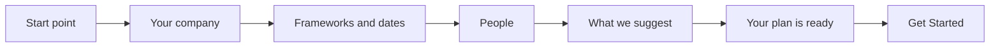
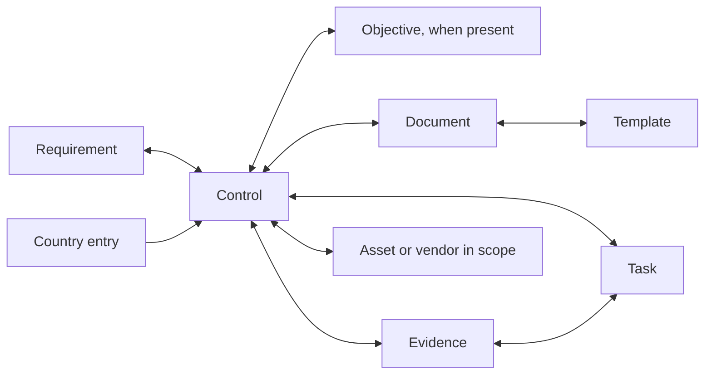

# Experience: setup, Get Started, and how every step links into the product

Part 3 of the guided onboarding plan. Read [README.md](README.md) first. Requirement ids refer to
[part 2](02-requirements.md). The design system is `docs/design-system.md` and it wins wherever this
part is silent.

## 1. Principles

1. **Ask once, show what it changed.** After an answer the user sees its effect ("12 physical
   security items suggested as not applicable"), so no question feels pointless.
2. **Ten minutes to a real plan.** The first sitting ends on a Get Started page that already knows
   the company, the frameworks, the dates and who owns what.
3. **A step is a door.** Every step opens the real page, filtered to exactly what the step counts.
   There is no second, simplified copy of the product inside the guide.
4. **Done is computed.** Nothing completes on a click. Skipping is allowed, named and visible.
5. **Suggest, then wait.** Anything that changes a compliance record is a suggestion with its
   reason, and a person decides.
6. **One fact, one place.** The profile is the same page from Settings and from Get Started.
7. **Counts, not a score.** "9 of 22 approved" tells the user what to do. A percentage does not.
8. **Less text.** One line of help per section. Detail sits behind a "Why we ask" popover.
9. **Popups for one decision, pages for work.** A dialog holds one focused decision and stays
   under 720 pixels wide and 70 percent of the height. Anything longer is a page.
10. **Nobody is locked in.** Setup can be left at any point and picked up later. Every product
    page is reachable from the first minute.

## 2. Where things live

| Screen | Address | New or existing |
|---|---|---|
| Get Started (landing page) | `/quick-start` | Existing, rebuilt |
| Setup (first run flow) | `/setup` and `/setup/:step` | New page, resumable |
| Company profile | `/settings/organization/profile` | Existing, rebuilt as typed sections |
| Ownership | `/settings/organization/ownership` | New |
| Engagement | `/frameworks/engagement?framework=CODE` | New tab beside Scope |
| Scope | `/frameworks/scope?framework=CODE` | Existing, gains scope items and commitments |
| Applicability | `/frameworks/soa?framework=ISO27001` | Existing, gains versions |
| Review list (suggestions) | `/quick-start/review` | New |
| Baseline | `/quick-start/baseline` | New |
| Work plan | `/quick-start/plan` | New |
| Required documents | `/documents/required` | New tab on Documents |
| System description | `/frameworks/description?framework=SOC2` | New |
| Internal audit, management review, audit record | `/frameworks/assurance?framework=CODE` | New |
| Country reference | `/frameworks/regulations` | New |
| SOC 1 guidance | `/frameworks/soc1` | New, shown only when the profile says so |

Links always carry the framework to a tab path, never to `/frameworks` alone (NV-6).

## 3. First run: setup

A full page flow with a short step rail on the left and one question group per screen. Six
screens. Each saves on Continue. Leaving and returning lands on the first unanswered screen.



### 3.1 Screen by screen

| # | Screen | Asks | Primary action | Can skip? |
|---|---|---|---|---|
| 1 | Start point | "Starting fresh" or "We already have a programme". Then "Who asked for this, and by when?" (one line, one date, both optional) | Continue | No, one click |
| 2 | Your company | The 16 core profile questions in five groups: about, where you operate, how you work, systems, data. One group per view, progress shown as "2 of 5" | Continue, and Confirm profile on the last group | "Not sure yet" per question. "Finish later" leaves the profile in draft |
| 3 | Frameworks and dates | Framework cards, then for each chosen one: type, key date, outside party or "still deciding" | Continue | Dates can be "to be agreed" |
| 4 | People | Eight functions, each a person picker with "Invite someone" | Continue | "I will do this later" keeps unassigned functions on Get Started |
| 5 | What we suggest | The review list, grouped, with counts. Accept groups or open each | Accept and continue | "Review later" keeps everything as suggestions |
| 6 | Your plan is ready | Three numbers (suggestions accepted, documents needed, tasks drafted), the nearest date, one button | Open Get Started | n/a |

For "We already have a programme", screen 2 is followed by one extra screen: reports and
certificates you hold, and "Import your documents" (EX-1 to EX-3).

### 3.2 Screen 2 layout

```
Setup                                                        Save and finish later

 1 Start point      Where you operate                                      2 of 5
 2 Your company
 3 Frameworks       Where is the company registered?
 4 People           [ Search countries                          v ]
 5 What we suggest
 6 Ready            Where do you have staff or offices?
                    [ Pakistan x ] [ United Arab Emirates x ] [ Add a country  v ]
                      United Arab Emirates: ( ) Onshore  ( ) DIFC  ( ) ADGM

                    Where are your customers and the people whose data you hold?
                    [ European Union x ] [ United States x ] [ Add a country or region  v ]

                    Why we ask: it decides which laws we show you for reference
                    and what goes into your obligations register.

                                                        [ Back ]   [ Continue ]
```

Rules for the form:

- Label above the field. One primary button per screen. Help is one line under the group.
- Yes or no questions are segmented controls with "Not sure yet" as a third option, never a
  dropdown.
- Many of a list uses chips with a searchable add control.
- A follow up appears under its parent the moment it becomes relevant, and disappears with it.
- Prefilled answers carry a small "From your connections" or "From sign up" note and count as
  answered only after the user moves past them.
- After the last group: a summary on one screen, grouped, each line editable in place, then
  **Confirm profile**.

### 3.3 Screen 3: frameworks

```
Which frameworks are you working towards?                    [ Help me choose ]

  [x] SOC 2                              [x] ISO 27001
      A report from a CPA firm.              A certificate from an accredited body.
      Asked for by security teams,           Asked for in Europe, the Gulf, Asia
      mostly in North America.               and Australia.
      Typical first report: 7 to 9 months.   Typical: 4 to 8 months.

  Adding ISO 27001: 99 of your controls already count. 17 are new.

SOC 2
  Type        (o) Type 1, design at a date     ( ) Type 2, operation over a period
  As of date  [ 2027-03-31 ]   or  [ ] To be agreed
  Audit firm  [ Name of firm              ]   or  [ ] Still deciding

ISO 27001
  Audit       (o) First certification
  Stage 1     [ 2027-05-12 ]   or  [ ] To be agreed
  Body        [ Name of certification body ]   or  [ ] Still deciding
```

"Help me choose" is a small dialog with three questions and one suggestion with its reason (FS-2).
"Typical" durations carry the word typical and a tooltip: "From audit firm guides. Your auditor
sets the real timeline."

### 3.4 Screen 5: what we suggest

```
Based on your answers we suggest 41 changes. Nothing is applied until you accept.

  Controls that may not apply                                   9    [ Review ]
    Because you have no offices and run nothing on your own hardware.
  ISO 27001 applicability                                      14    [ Review ]
    Reasons are prefilled for your Statement of Applicability.
  SOC 2 categories                                              1    [ Review ]
    Availability, because you promise uptime to customers.
  Owners                                                      116    [ Accept all ]
    From the people you just named.
  Documents you need                                           24    [ See list ]
  Systems to connect                                            3    [ See list ]

                                           [ Review later ]   [ Accept and continue ]
```

"Accept all" exists only on groups that part 5 marks safe (owners, hiding guidance, documents
needed, connection suggestions). Applicability groups open the review list (PL-5).

## 4. Get Started

The landing page after sign in, for every role. It is the programme home after the first audit too.

```
Get Started                                           [ Add a framework ]  [ Company profile ]

[ SOC 2 Type 2 . period 1 Feb to 30 Apr 2027 . auditor still deciding ]
[ ISO 27001 . Stage 1 on 12 May 2027 . certification body named ]

Next
  Record your internal audit                                   ISO 27001
  Blocks Stage 1 in 5 weeks. Owner: Sara Khan (security lead)   [ Open ]

Shared foundation                                              18 steps, 7 done
  v Describe
      Confirm your company profile            SOC 2  ISO     Done
      Set your scope                          SOC 2  ISO     Waiting for approval
      Decide what applies                     SOC 2  ISO     In progress   3 suggestions open
  v Organise
      Assign who owns what                    SOC 2  ISO     In progress   112 of 116 controls
      Invite your team                        SOC 2  ISO     Done
  > Assess          2 steps, 0 done
  > Build           3 steps, 0 done
  > Operate         4 steps, 0 done

SOC 2                                    ISO 27001
  Choose your categories      Done         Go live with your management system   Not started
  Write your system description  Draft     Run your internal audit               Not started
  Start your period    Starts 1 Feb        Hold your management review           Not started

Where you stand
  SOC 2     Criteria with support 14 of 61   Documents 9 of 22   Evidence current 31 of 116   Checks passing 22 of 37
  ISO 27001 Requirements with support 40 of 123   Documents 9 of 35   Evidence current 31 of 133   Checks passing 22 of 37

Timeline
  SOC 2      [ policies approved ]......[ period starts ]..............[ period ends ][ fieldwork ]
  ISO 27001  [ policies approved ]..[ live ]...[ internal audit ][ review ][ Stage 1 ]..[ Stage 2 ]
             Nov        Dec        Jan        Feb        Mar        Apr        May        Jun
                              ^ today
```

Behaviour:

| Element | Rule |
|---|---|
| Header chips | One per engagement in planning or in progress. Click opens the engagement. A framework with no date reads "no date yet" |
| Next | One item only: the first open step that blocks the nearest dated milestone (GS-8). With no dates, the first open step in phase order |
| Phases | The current phase is open, later ones collapsed with their counts. The user's choice of open sections is remembered per history entry |
| Step row | Title, framework chips, state, one figure. The whole row is a link. A step the user may not act on shows "Ask [owner name]" in place of the link |
| Framework lanes | Side by side on wide screens, stacked below 1024 pixels. Only steps specific to that framework |
| Where you stand | One row per framework, four separate figures, each a link to the filtered list. No total |
| Timeline | Planned milestones as outlined markers, actual as filled. Today is a vertical line. Hover or focus shows the date and the step it belongs to |
| Your part | For a member who does not hold `controls:manage`: replaces "Shared foundation" with their own open items grouped by step (GS-12). The rest of the page stays as context, collapsed |
| Skipped steps | Shown in place, greyed text plus the words "Skipped by [name] on [date]: [reason]" and a Reopen link |

States:

| State | What the user sees |
|---|---|
| First visit, setup not started | A single card: "Tell us about your company, about ten minutes" with Start setup, and a quiet link "Skip setup and explore" |
| Setup left half way | The same card reading "Continue setup, 3 of 6" above the normal page |
| Loading | Skeleton rows in the page's own layout, no spinner over the page |
| A section the role cannot read | One line in that section: "Your role cannot see team setup" (GS-1) |
| Status endpoint failed | The header and links still render. One inline message with Try again. Never a blank page |
| Everything done | Next reads "Nothing is blocking your next date" and shows the next milestone |

## 5. Review list

Address `/quick-start/review`. A register of suggestions with a detail panel.

```
Suggestions                    [ Open 24 ] [ Accepted 17 ] [ Rejected 2 ] [ Needs another look 1 ]

Kind: [ All v ]   Framework: [ All v ]

  PE-02 Office access control                Suggest: not applicable            ISO  SOC 2
  A.7.1 Physical security perimeters         Suggest: applicable, operated by your office provider
  A.8.30 Outsourced development              Suggest: excluded

  ................................................................ detail panel
  A.8.30 Outsourced development
  Suggested because you answered: "Do outside developers write code for you? No"

  Decision    ( ) Applicable   (o) Not applicable
  Reason      [ Not applicable. Northwind does not use outside developers within the scope
                stated in ISMS scope statement v1. No risk in the register reviewed on
                2027-01-10 calls for this control. Reassess if development is outsourced. ]

  [ Reject ]                                                         [ Accept ]
```

Rules: the reason is editable and required. Reject asks for a short reason. "Needs another look"
holds decisions touched by a later change (PL-4), each showing what changed. Rows for clauses 4 to
10 and the security criteria never appear (SC-7).

## 6. Required documents

A tab on Documents.

```
Documents      Register   Required   Templates   Campaigns

Needed for: [ All v ]    State: [ All v ]                     22 needed, 9 approved, 3 in review

  Document                              Needed for    State               Owner        Supports
  ISMS scope statement                  ISO           Approved            S. Khan      GOV-23
  Policy statement by top management    ISO  SOC 2    No template yet     A. Malik     GOV-17  CS-04      [ Upload ]
  Access control policy                 ISO  SOC 2    Not started         R. Ahmed     IAM-01 +7          [ Start from template ]
  Risk register                         ISO  SOC 2    4 risks, 1 not assessed          GOV-18 +2          [ Open Risks ]
  Acceptable use policy                 ISO  SOC 2    Approved, not sent to staff      GOV-17 +2          [ Send for acknowledgement ]
```

Rules: one action per row, the next sensible one. "Supports" shows two control codes and "+n",
and opens the control. Rows whose condition is not met by the profile do not appear, and a quiet
line under the table says "3 documents are hidden because of your profile" with a link that lists
them and the answer behind each. Importing existing files is one button above the table that opens
the matching dialog (EX-3).

## 7. Ownership

```
Who owns what

  Function                     Person                            Controls   Documents
  Executive sponsor            [ Ayesha Malik            v ]           4           3
  Security lead                [ Sara Khan               v ]          31           9
  Engineering lead             [ Invite someone          v ]          27           4      Invited: omar@northwind.example
  IT lead                      [ Rashid Ahmed            v ]          29           5
  HR lead                      [ Choose a person         v ]          11           3
  ...

  ! Sara Khan would own the internal audit and 31 of the controls it checks.
    Most small companies ask an outside reviewer to do the audit.          [ Learn more ]

                                                    [ Apply owners to 116 controls ]
```

The counts update as people are chosen. "Apply owners" opens a confirm dialog listing how many
controls gain an owner and how many already have one, with "Keep existing owners" checked by
default (OW-2).

## 8. Engagement

A tab in Frameworks. One page per framework with four blocks: **What and when** (type, dates),
**Who** (outside party, signers, approvers), **Milestones** (editable dated list, planned and
actual), **History** (earlier engagements, read only). For SOC 2 Type 2 a fifth block lists
**Changes in the period**. Dates use the native date field. A date can be set to "to be agreed"
with a checkbox, which clears it.

The periodic controls check (EN-8) is a small table at the bottom: control, how often, last done,
"inside the period: yes or not yet".

## 9. Scope

The existing page gains three sections under the scope statement:

1. **What is in scope**: scope items in a table grouped by kind, each row in or out. Out opens a
   small dialog for the reason. "Suggested from your records" items carry an Accept control.
2. **What you promise customers**: the commitments register (SC-8), three columns: promise, where
   it is written, what it points at.
3. **Vendors that count**: vendors marked for this engagement with their method and the expiry of
   their own report (SC-9).

For SOC 2 the categories block shows security as fixed and "always included", then the four
electives each with a suggestion line when one exists.

## 10. Baseline

A focused pass, one family per screen, eleven screens.

```
Where do you stand today?        Access management, 12 controls                      2 of 11

  IAM-01 Access is granted by request and approval     [ In place ] [ Partly ] [ Not in place ] [ Not sure ]
  IAM-02 Access is removed when people leave           [ In place ] [ Partly ] [ Not in place ] [ Not sure ]
  ...
  This is your own view. It sets the order of work. Your readiness figures change only with evidence.

                                                         [ Back ]   [ Save and continue ]
```

Each control name is its plain title. A small "What this means" link opens the control's
statement in a popover. No "mark all in place" control exists.

## 11. Work plan

```
Your draft plan                                   42 tasks, first due 14 Dec, last due 28 Apr

  Approve documents        22 tasks     Owners: 5 people      [ Show ]
  Connect systems           3 tasks     Owner: R. Ahmed       [ Show ]
  Collect evidence         11 tasks     Owners: 6 people      [ Show ]
  ISO management system     4 tasks     Owner: S. Khan        [ Show ]
  Vendors                   2 tasks     Owner: N. Baig        [ Show ]

  Due dates are worked back from your Stage 1 date, 12 May 2027.

                                              [ Not now ]   [ Create 42 tasks ]
```

Each group expands to its tasks with assignee and due date editable before creation. After
creation the page shows what was created and links to the Tasks register filtered to this plan.

## 12. Country picker

One component, `CountrySelect`, single or many, built on the existing `SearchableSelect`. No new
dependency.

| Topic | Decision |
|---|---|
| List | The 249 entries of ISO 3166-1, stored by two letter code, shown by common English short name. A static file in the frontend, about 12 kilobytes, with aliases |
| Regions | Selectable groups at the top of customer and data questions: European Union (27), European Economic Area, Gulf Cooperation Council, Worldwide. A group is stored as its own code, and the country panel expands it |
| Aliases | UAE, Emirates, KSA, Saudi, UK, Britain, England, USA, US, America, Holland, Czechia and Czech Republic, Turkey and Türkiye, Ivory Coast, South Korea, Russia, and local names for the covered countries |
| Matching, in order | 1 name starts with the text. 2 any word of the name starts with it. 3 an alias or code matches. 4 the text appears anywhere. 5 spelling tolerance: one wrong, missing, extra or swapped letter for up to five letters typed, two for longer |
| Spelling tolerance | "Pakstan", "Pakisten", "Saudia Arabia", "Untied States", "Austrailia" all find their country. Case and accents are ignored |
| No match | "No country matches 'Atlantis'." with the three closest names offered as "Did you mean" |
| Order | Matches by rule order, then by name. With nothing typed: the workspace's registered country first, then the full list by name |
| Many | Chosen countries are chips above the field, removable by click or Backspace. The list stays open after a choice |
| Sub choices | United Arab Emirates asks for onshore, DIFC or ADGM. United States offers optional states. Shown inline under the chip, only for staff and office questions |
| Display | A two letter code tag before each name (PK, AE). No flag pictures: flag emoji do not render on Windows, and flags are a naming risk |
| Keyboard | Type to filter, arrows to move, Enter to choose, Escape to close, Backspace on an empty field removes the last chip |
| Screen readers | The combobox pattern with a labelled list. Each choice is announced with the count: "Pakistan added, 2 countries selected" |
| Covered countries | In the list, a quiet "reference available" tag marks countries the catalogue covers (part 4). All others stay selectable |

The same matching helper serves any long list later (industries, tools), so it lives in
`shared/lib` and is tested on its own with the misspellings above.

## 13. Country reference panel

Address `/frameworks/regulations`, also shown in short form after the "Where you operate" group in
setup and as a card on the profile page. Content and wording rules are in part 4.

```
Rules that may apply to you            Reference only. Not legal advice.   Last reviewed 4 Nov 2026

[ PK Pakistan ] [ AE United Arab Emirates, onshore ] [ EU European Union ] [ US United States ]   [ Edit countries ]

At a glance
                 Privacy             Security baseline     Breach clock    Data location     Sector        AI
  Pakistan       Bill, not law       National CERT rules   none set        none general      none shown    none
  UAE            PDPL  In force      IA standard  Sector   none set yet    health data       none shown    none
  EU             GDPR  In force      NIS2  Phasing         72 hours        transfer rules    none shown    AI Act  Phasing
  United States  State laws  Varies  NIST CSF  Voluntary   varies by state none general      none shown    State laws

Most companies here should know                                                      6
  [ GDPR ]  In force
    Shown because your customers are in the European Union.
    Breach notice within 72 hours. Transfer rules. Records of processing.
    Your ISO 27001 work helps with security. It does not cover privacy rights.
    Controls you run that help: 31     Not covered by Verity: 6 topics           [ Details ]

Depends on your sector                                                               4   >

Dates coming up
  2 Dec 2026   EU AI Act: end of the grace period for marking generated content
  1 Jan 2027   United States: two more state privacy laws start
  ...
```

Graphical elements, all drawn with existing tokens and the status pill:

| Element | Purpose | Rule |
|---|---|---|
| Country chips | What was chosen | Edit opens the profile section, the single source |
| At a glance matrix | Rows are countries, columns are six topics. A cell names the rule and its state | A cell is a link to its card. An empty cell says "none shown", never a tick or a cross |
| State pill | In force, in force with dates coming, passed and not yet in force, draft, suspended, voluntary | Fixed wording. Draft and suspended use the neutral style so they never read as law |
| Cards | One per entry: name, state, why it is shown, three to six headline duties in plain words, breach clock in hours when one exists, what helps, what is not covered | "Why shown" uses the three wordings of JC-3 |
| Dates coming up | A vertical list of dated changes for the chosen countries, next eighteen months | Unconfirmed dates read "expected" |
| Details drawer | Full entry: who it applies to, duties, relation to ISO 27001 and SOC 2, sources, last reviewed, "Report an error" | Opens from the card, keeps the page behind |
| Relevant or not | Two quiet buttons on each card, with an optional note | Recorded as the user's decision (JC-6) |

No map. Chips and the matrix answer the question faster, work on small screens, and need no new
dependency. No score, ring, gauge or percentage anywhere on this page.

## 14. Navigation map

Every door from Get Started, and how the user gets back.

| From | To | Address | Lands on |
|---|---|---|---|
| Confirm your company profile | Profile | `/settings/organization/profile` | First unanswered section |
| Choose frameworks and dates | Engagement | `/frameworks/engagement?framework=CODE` | What and when |
| Assign who owns what | Ownership, then controls | `/settings/organization/ownership`, `/controls?owner=unassigned` | The list of what is unassigned |
| Invite your team | People | `/settings/access/people?invite=1` | Invite dialog open |
| Set your scope | Scope | `/frameworks/scope?framework=CODE` | First item needing a decision |
| Decide what applies | Review list, Applicability | `/quick-start/review?state=open`, `/frameworks/soa?framework=ISO27001` | Open suggestions |
| Say where you stand | Baseline | `/quick-start/baseline` | First family not answered |
| Assess your risks | Risks | `/risks?state=not_assessed` | Risks without an assessment |
| Approve your work plan | Plan | `/quick-start/plan` | Preview |
| Connect your systems | Connections | `/connectors?tab=available` | Suggested systems first |
| Approve your policies and documents | Required documents | `/documents/required?state=open` | Open rows |
| Start from template (row) | Documents | `/documents?new=template&template=KEY` | Template dialog, template chosen |
| Ask staff to acknowledge | Campaigns | `/documents/campaigns` | Documents approved and not yet sent |
| Review your vendors | Vendors | `/vendors?review=due` | Vendors in scope without a current review |
| Collect evidence | Controls | `/controls?framework=CODE&evidence=none` | Controls with no current evidence |
| Fix what is failing | Controls | `/controls?framework=CODE&check=failing` | Failing checks |
| Write your system description | Description | `/frameworks/description?framework=SOC2` | First section to write |
| Run your internal audit, hold your management review | Assurance | `/frameworks/assurance?framework=ISO27001` | New record |
| Close findings | Tasks | `/tasks?type=corrective_action&state=open` | Open corrective actions |

Cross links inside the work (RD-9, NV-4):



Back always returns to the same place: the registers already keep filters, page and scroll per
history entry, and the new pages use the same mechanism.

## 15. New building blocks

| Component | Why | Notes |
|---|---|---|
| `StepRail` | Setup's left rail and the baseline's progress | Vertical list, current step marked, completed steps are links |
| `Meter` | "9 of 22" as a thin bar with the figure beside it | Always paired with the words. Not a percentage |
| `ChipSelect` | Choose many from a list | Built on `SearchableSelect`. Used by countries, tools, data types |
| `CountrySelect` | Section 12 | A `ChipSelect` or `SearchableSelect` with the country data and matcher |
| `DateField` | Engagement dates | The browser's native date input inside the standard field wrapper. No date picker library |
| `SegmentedChoice` with a third state | Yes, no, not sure | The existing segmented control with three options |
| `Timeline` | Milestones on Get Started and the engagement page | Plain SVG, two marker styles, today line. Follows the chart rules of the design system |
| `SuggestionRow` and its panel | Review list | Uses the drawer |
| `StepRow` | Get Started | Whole row is the link target |

Each is added to `components/ui`, exported from its index, and documented in the design system in
the same change.

## 16. Copy

| Place | Text |
|---|---|
| Setup title | Tell us about your company |
| Under it | About ten minutes. You can stop and come back. |
| Why we ask (countries) | It decides which laws we show you for reference. |
| Suggestion header | Based on your answers we suggest 41 changes. Nothing is applied until you accept. |
| Draft marker | Draft, written with AI. Read it before you send it for approval. |
| Skipped | Skipped by Sara Khan on 3 Dec 2026: we have no systems to connect yet. |
| Auditor undecided | Still deciding |
| SOC 2 card | A report from a CPA firm on how your controls are designed and how they operated. |
| ISO card | A certificate that your security management system meets ISO/IEC 27001:2022. |
| Typical time tooltip | From audit firm guides. Your auditor sets the real timeline. |
| Country panel banner | Reference only. Not legal advice. |
| Empty review list | No suggestions are waiting. Change your profile or scope and new ones will appear here. |
| Empty required documents | Choose a framework to see the documents it needs. |
| Role cannot act | Ask Rashid Ahmed, who owns this. |

Banned everywhere: "certified" for SOC 2, "compliant" as a state, "audit ready", a blended
percentage, and dash characters as punctuation or as empty cell placeholders.

## 17. Small screens and access

- Setup and Get Started work at 360 pixels wide: the step rail becomes a "3 of 6" line, lanes
  stack, the matrix on the country panel becomes one card per country.
- All actions are reachable by keyboard in visual order. Focus is visible.
- State is always words plus the pill, never colour alone.
- The timeline has a table view toggle listing the same milestones and dates.
- Motion is limited to the standard transitions and respects the reduced motion setting.

## 18. Left out on purpose

| Not built | Why |
|---|---|
| A wizard that blocks the product until finished | Users explore first. Setup is resumable instead |
| A readiness ring or blended percentage | It misleads (part 1, section 12) |
| A world map | Chips and a matrix do the job with no new dependency |
| Flag pictures | Do not render on Windows |
| A second simplified control list inside the guide | The real pages are the guide |
| Celebration effects | Not in keeping with the product |
| A date picker library | The native field is enough |
| A separate internal questionnaire builder | The profile is a fixed form. The vendor questionnaire engine stays for vendors |
