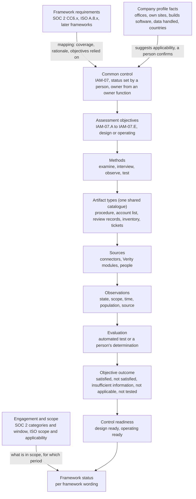

# Control library and assessment objectives: what guided onboarding needs

Part 5 of the guided onboarding plan. Read [README.md](README.md) first.

Guided onboarding turns answers about a company into work: which controls apply, who owns them, which
documents to write, what proof to collect. That only works if the library can answer those questions
from content. Today it cannot. This part lists what must change in the library and how the assessment
objectives designed on 2026-10-30 are rolled out so that the guidance is real.

Sources: the internal compliance review of 2026-11-21 (ISO 27001 lead auditor, PCI DSS QSA, SOC 2 and
banking perspective; finding ids `LD-nn` below), the shipped packs under
`backend/src/verity/seed/content/`, `readiness.py`, and the research report "Framework independent
assessment model" (2026-10-30). The review is Verity's own pass. It is not an independent or
accredited review, and FW-5 (sign off by a second qualified person) stays open.

## 1. How the pieces connect

Onboarding touches this chain in four places:

1. **Profile facts** propose which controls apply (section 4). A proposal is a draft that a person
   confirms.
2. **Owner functions** propose who owns each control (section 5).
3. **Artifact types** are what the "required documents" list and the evidence requests are made of
   (sections 3 and 6).
4. **Objectives** are what the guidance on each control page walks through, one line at a time
   (section 8).

## 2. Findings that block or shape the plan

| Id | Severity | Finding | Where it is handled |
|---|---|---|---|
| LD-01 | critical | Seven of the fifteen Openlane templates follow the wording and titles of the 2013 edition of ISO/IEC 27001 Annex A. Apache 2.0 from Openlane cannot grant rights in a standard's text. Every workspace that starts a policy from them receives a copy. | CL-1 |
| (existing) | critical | The SOC 2 pack ships the AICPA criterion text verbatim (`verbatim: true` in its manifest). Already listed as an open decision. Onboarding puts that text on more screens. | CL-2 |
| LD-14 | critical | Readiness ignores `coverage`. Nine SOC 2 criteria rest on one partial control each (CC5.2, P3.2, P6.5, P6.7, P7.1, PI1.1, PI1.2, PI1.4, PI1.5) and read as met when that control is ready. | CL-3 |
| LD-02 | major | Nothing binds a document template to a control. 60 expected evidence items are documents, 30 templates exist, and a draft started from a template is linked to nothing. | CL-4 |
| LD-03 | major | The `satisfies` lists on templates claim coverage the text lacks and miss coverage it has. 27 of 61 SOC 2 criteria appear on no template. | CL-4 |
| LD-04 | major | No check confirms that the documents a framework needs exist. One published template document is enough for the policy check to pass. | CL-5 |
| LD-05 | major | The acknowledgement check passes when the security policy was never sent to staff. | CL-5 |
| LD-08, LD-09 | major | No shipped document meets ISO clause 5.2 (policy statement by top management) or clause 8.1 (operating plan). | CL-6 |
| LD-13 | major | Verity has no SOC 2 system description: no template, no object. A Type 1 cannot start without one. | CL-6, EN-6 in part 2 |
| LD-10, LD-11 | major | Technical standards and privacy documents that evidence items expect have no template. | CL-6 |
| LD-22 | major | Control templates carry no applicability condition and the profile has no structured facts. | CL-7 |
| LD-23 | major | No owner hint on any control. | CL-8 |
| LD-17 to LD-21 | major, minor | Ten automated controls read ready on a policy upload alone. 19 evidence items ask for a self selected "sample". Many item names give a newcomer nothing to act on. | CL-9 |
| B3 | major | SOC 2 mapping gaps (A1.2, CC6.7, CC2.1, CC5.1, CC9.1, P8.1) and five ISO pack controls that SOC 2 only workspaces cannot adopt. | CL-10 |

## 3. Library requirements (CL)

| Id | Requirement | Acceptance |
|---|---|---|
| CL-1 | Shipped templates contain no sentences or headings that follow a standard's text. The seven affected Openlane templates (`access-control-policy`, `asset-management-policy`, `operations-security-policy`, `physical-security-policy`, `secure-development-policy`, `third-party-management-policy`, `human-resource-security-policy`) are rewritten in plain wording or replaced by Verity written ones. `NOTICE.md` states the change, as Apache 2.0 requires. | A content test fails when a template contains a phrase from a maintained list of standard phrases. `NOTICE.md` lists what was changed. Legal has read the result before it ships. |
| CL-2 | The SOC 2 pack carries identifiers and Verity's own short names, like the ISO pack (`text_policy: id_only`). The loader refuses a pack whose content breaks its stated text policy. | `soc2/requirements.json` has no verbatim criterion text. A pack marked `id_only` with a text field longer than a set limit fails to load. Needs the owner's decision on the AICPA licence first (decision D-4 in the README). |
| CL-3 | A requirement whose only mapped control is partial never reads as met. | A content test fails any requirement with a single partial mapping. Until content is fixed the requirement shows "Partly covered by design". The mapping changes in section 7 remove the nine cases. |
| CL-4 | Every document template names the controls and the evidence item it answers: `controls: [{code, evidence_key}]`. Starting a draft from a template links the draft to those controls. The framework chips on a template are derived from those controls' mappings. The label reads "Supports", never "Satisfies". | A draft started from `access-control-policy` is linked to IAM-01, IAM-02 and the other bound controls without any manual step, and one audit row records the links. The hand written `satisfies` lists are gone. |
| CL-5 | Each template states `required_for` (framework codes) and `required_when` (a profile fact, optional). A built in check `verity.documents.required_present` gives one result per required document for each framework the workspace runs. Documents that all staff must acknowledge are marked `acknowledge: all_staff` on the template (code of conduct, acceptable use, security policy, policy statement). | The Required documents list (part 3) and the check agree for every workspace. A workspace with no security policy sent to staff fails the acknowledgement check. |
| CL-6 | The missing templates are written by Verity, in this order: `information-security-policy-statement`, `isms-operating-plan`, `soc2-system-description`, `business-impact-analysis`, `infrastructure-security-standard`, `engineering-security-standard`, `endpoint-security-standard`, `joiner-mover-leaver-checklists`, `privacy-notice-outline`, `privacy-requests-and-complaints-procedure`, `personal-data-handling-procedure`, `processing-integrity-procedure`, `oversight-body-charter`, `site-and-equipment-protection-standard`. Each is reviewed before it ships. Privacy templates are read by privacy counsel. | Appendix A has no row marked Missing for a document that applies to a cloud software company running SOC 2 and ISO 27001. |
| CL-7 | Control templates carry `applies_when`: a rule over profile facts. Onboarding uses it to propose a control status and, for ISO, a Statement of Applicability decision with a prefilled reason. Nothing is applied without a person's confirmation. | Section 4. A "no offices" answer produces a proposal for PE-02, never a silent change, and accepting it writes an audit row with the reason. |
| CL-8 | Every control template carries `owner_function`, one of eight keys. Onboarding maps each function to a member once and proposes owners from it. | Section 5. After the ownership step every adopted control has a proposed owner, and the independence warning shows when one person would own the internal audit control and most other controls. |
| CL-9 | Evidence items become instructions a newcomer can follow: each has `what`, `where`, `shows` and `if_none`. The 19 "sample of" items are renamed to the full list the auditor samples from. The thirteen controls that read ready on a policy alone gain a manual operating item. An incident register item is added. | Section 6. No evidence item name starts with "Evidence" or "Sample of". Evidence items are read from the template at request time, so this needs no data migration. |
| CL-10 | The SOC 2 mapping additions of section 7 are made, and the five ISO pack controls that SOC 2 needs (PE-03, DM-19, HR-09, CS-06, LM-12) move to where every workspace can adopt them, with a backfill for existing workspaces. | A SOC 2 only workspace can adopt DM-19. A1.2 has a control that covers environmental protection. An existing workspace gains the new controls after the backfill, with an audit row. |

### Wording patterns for CL-1

The review rewrote six places to set the pattern. The full list is in the review notes.

| Template | Section | New heading | New sentence |
|---|---|---|---|
| `access-control-policy` | powerful utility software | Administrative tools that can bypass controls | Tools that can change system settings or get around application safeguards are installed only for named administrators, and each use is logged. |
| `asset-management-policy` | first policy section | Asset register | {{company_name}} keeps a register of the systems, devices and data stores that hold or process classified information, and keeps it current. |
| `physical-security-policy` | outside hazards | Fire, flood and other hazards | Each site is assessed for fire, flood, power loss and deliberate damage, and fitted with protections that match the result. |
| `operations-security-policy` | logging | Activity logs | Systems record user actions, errors and security events. Logs are kept for the period set in this policy and reviewed by automated rules or a named person. |
| `operations-security-policy` | audit considerations | Testing on live systems | Any audit or test on a live system is planned with the system owner and timed to limit disruption. |
| `secure-development-policy` | test data | Test data | Test data is chosen deliberately and protected. Customer data is used for testing only when masked and approved by the data owner. |

## 4. Profile facts and what they switch (CL-7)

Two rules of the engine shape every default:

- A control marked not applicable drops out of every framework, and a requirement with no applicable
  control left reads not met.
- ISO exclusions are per requirement, with "operated by" set to the organization or a supplier.

So a "no" answer proposes a control status and, for ISO, an applicability decision. Three reason
patterns are prefilled for the person to edit:

- **Operated by a supplier:** "Applicable. Operated by [supplier] for [facilities or service].
  [Company] relies on [report or certificate, issuer, period or expiry], reviewed on [date] under
  PE-01. [Company] keeps these duties: [list]."
- **Excluded:** "Not applicable. [Company] does not [activity] within the scope stated in [scope
  document and version]. No risk in the register reviewed on [date] calls for this control. Reassess
  if [trigger]."
- **Included:** "Applicable. Needed for [risk ids, or legal or contract duty, or customer
  commitment]. Implemented through [control codes]."

| Profile fact | Controls it switches | ISO Annex A it switches | Default when the answer is no | Safe to automate? |
|---|---|---|---|---|
| Runs its own data centre, server room or comms cabinet | PE-03, PE-02 (server areas), NS-12, BC-03 (secondary site) | A.7.5, A.7.8, A.7.11, A.7.12, A.7.13 | PE-03 draft not applicable. The five requirements stay applicable with `provided_by: supplier` and the supplier operated pattern. Never excluded. | Draft only. A person confirms, with the provider report attached. |
| Has offices (none, managed shared office, own premises) | PE-02, PE-03 | A.7.1 to A.7.4, A.7.6 | No office: PE-02 draft not applicable, the requirements stay applicable through PE-01 as supplier operated. A.7.7, A.7.9, A.7.10, A.7.14 always stay with the organisation. | Draft only. |
| Develops software in house | SD-02, SD-03, SD-05, SD-06, SD-10, SD-11, SD-12, DM-13, DM-18 | A.8.4, A.8.25, A.8.27, A.8.28, A.8.29, A.8.31, A.8.33 | Draft not applicable with the excluded pattern. SD-01, SD-04, SD-13, SD-14 and A.8.32, A.8.26, A.5.8 stay, since configuration and purchased systems still change. | No. Scripts, infrastructure code, websites and low code all count. CC8.1 cannot be excluded. Person decides. |
| Uses outside developers | BC-08 (supplier code sentence), HR-03, SD-06 | A.8.30 | A.8.30 draft excluded. | Draft only. |
| Stores, processes or transmits card data (or fully outsourced to a payment provider) | Conditional sentences in BC-08, PE-01, PE-03, IAM-06, IAM-07, IAM-09, NS-06, NS-07, GOV-16, GOV-23, LM-11, DM-18, EP-07, BC-05 | none | Hide the card data sentences and the PE-03 payment device evidence item. Nothing becomes not applicable. | Yes for hiding guidance. Outsourced card handling still leaves duties, so show the PCI reference panel. |
| Handles health data | Conditional sentences in EP-01, EP-07, GOV-15, HR-08, IAM-03. Appendix C of `incident-response-plan` | none | Omit the appendix and sentences. | Yes for hiding. |
| Personal data role: controller, processor, both, or staff data only | DM-01, DM-02, DM-03, DM-05, DM-07, DM-09, DM-10, DM-11, DM-12, DM-14, DM-15, DM-17, BC-06 | A.5.34 (seven partial controls) | Staff data only: keep DM-10, DM-12, DM-15 and GOV-05 for A.5.34 and propose removing the A.5.34 links of DM-03, DM-05, DM-11 with a reason. Processor only: reword DM-03, DM-07, DM-15 as "support the controller". | No. A.5.34 is never excluded (every company holds staff data). Which Privacy criteria apply to a processor is agreed with the service auditor. |
| Shares customer data with subprocessors | BC-06, DM-09, DM-10, DM-17 | A.5.19 to A.5.23 never switch | BC-06 draft not applicable. | Draft only. Check against the vendor register first: a vendor flagged as holding personal data contradicts a "no". |
| Workforce: employees, contractors, both | HR-03, HR-07 | A.5.11, A.8.30 (other controls remain) | No contractors: HR-03 draft not applicable. | Draft only. HR-01, HR-02, HR-05, HR-06, HR-08 always apply. |
| Remote or hybrid working | NS-11, EP-03, EP-05, `remote-working-policy` | A.6.7 | A.6.7 draft excluded only if no device ever leaves the premises. | No. On call from home and travel count. Person decides. |
| Company devices, personal devices, or both | EP-01 to EP-07 | A.8.1, A.7.9 | Personal devices only: keep the controls and switch guidance to the personal device rules. | Guidance switch only. |
| SOC 2 categories elected | Availability: BC-02, BC-04. Confidentiality: DM-04, DM-06, DM-08, DM-13. Processing Integrity: SD-05, SD-07, SD-08, SD-09. Privacy: DM-01, DM-02, DM-03, DM-05, DM-07, DM-09, DM-11, DM-12, DM-14, DM-15, DM-17 | none | Show these 21 controls as "not needed for your SOC 2 scope" unless ISO keeps them. Five have no ISO link at all: DM-02, DM-07, DM-14, SD-07, SD-08, SD-09 are SOC 2 only. | Yes for hiding from the work list. Do not set not applicable when ISO is active. |
| Public internet facing application | NS-10, SD-05, GOV-16 scope | A.8.21 | NS-10 draft not applicable. | Draft only. |
| Oversight body: board with independent members, or executive team only | GOV-02 (item "Record of who sits on the body and their independence"), GOV-21 | none | Reword to executive oversight and drop the independence record. | Guidance switch. Never not applicable. |
| Services that affect customers' financial reporting | GOV-14, IAM-09, GOV-12, SD-08, SD-09 | none | No change. | Yes. A yes shows the SOC 1 guidance of section 9. |
| Countries of operation and regulators | GOV-05, CS-07, DM-01, the country panel of part 4 | none | No panel. | Yes. |

The last column is binding on the design: where it says "No" or "Draft only", the product shows a
proposal with its reason and waits for a person.

## 5. Owner functions (CL-8)

Eight functions: executive sponsor, security lead (ISMS manager), engineering lead, IT lead, HR lead,
legal or privacy lead, vendor or procurement lead, finance lead. One member can hold several.

| Family | Default function | Exceptions |
|---|---|---|
| GOV | security lead (ISMS manager) | GOV-02, GOV-10, GOV-15, GOV-26: executive sponsor. GOV-04, GOV-11, GOV-21: HR lead. GOV-05: legal or privacy lead. GOV-12: finance lead. GOV-14: IT lead. GOV-13: a person who does not own the controls being audited (see note). |
| IAM | IT lead | IAM-07, IAM-10: engineering lead for production systems. IAM-09: finance lead for financial systems, IT lead otherwise. |
| HR | HR lead | HR-08, HR-09: security lead. HR-03: vendor or procurement lead where contractors come through suppliers. |
| SD | engineering lead | none |
| LM | engineering lead for LM-02, LM-03, LM-06, LM-08, LM-09 | LM-01: IT lead. LM-04, LM-05, LM-07, LM-10, LM-11, LM-12: security lead. |
| DM | legal or privacy lead | DM-04: security lead. DM-06, DM-13, DM-16, DM-18: engineering lead. DM-19: IT lead. |
| NS | engineering lead | NS-11: IT lead. NS-06: engineering lead operates, security lead approves key access. |
| EP | IT lead | none |
| PE | IT lead | PE-01: vendor or procurement lead. |
| BC | engineering lead for BC-01, BC-02, BC-04 | BC-03: executive sponsor accountable, engineering lead owner. BC-05: IT lead. BC-06: legal or privacy lead. BC-07, BC-08: vendor or procurement lead. |
| CS | security lead | CS-01, CS-02: legal or privacy lead. CS-05: HR lead. |

Warnings the ownership step must raise:

- One member owns GOV-13 (internal audit) and most of the controls it audits. The usual answer in a
  small company is an outside reviewer, which the GOV-13 guidance already allows.
- The same member requests and approves a risk acceptance.

## 6. Evidence items a newcomer can act on (CL-9)

Four short fields on every evidence item, shown on the control page:

| Field | Meaning | Example for LM-02 |
|---|---|---|
| `what` | The record, named as a thing | Monthly log review record |
| `where` | Where a small company usually finds it | The ticket or checklist the reviewer completes, with the saved search or alert report attached |
| `shows` | What a good one contains | Date, reviewer, sources covered, what was found, what was done |
| `if_none` | What to file when nothing happened | A signed note "no exceptions in [period]" with the query that returned nothing |

**Samples become populations.** An auditor selects the sample from a complete list. A company that
picks its own sample hands over evidence the auditor will not rely on. The 19 items (on CS-03, CS-06,
DM-11, DM-18, GOV-11, HR-01, HR-02, HR-06, IAM-01, IAM-12, LM-04, NS-05, NS-12, SD-01, SD-02, SD-06,
SD-10, SD-13, SD-14) are renamed on this pattern: "List of all [events] in the period, with
[fields]. The auditor chooses the sample from it."

**Manual operating items until a connector collects them** (these controls read ready on a policy
upload alone today):

| Control | New evidence item (operating) | Cadence |
|---|---|---|
| IAM-03 | Sign in policy export showing the second factor is required, and the list of users with an enrolled factor | quarterly |
| IAM-04 | Export of applications behind single sign on, and of applications outside it | quarterly |
| IAM-05 | Password manager member list compared with the staff list | quarterly |
| IAM-06 | Password settings export from the identity provider | annual |
| IAM-08 | Export of groups or roles and their members for each in scope system | quarterly |
| IAM-11 | Session limit settings export | annual |
| NS-01 | Encryption setting for every data store, exported from the cloud console | quarterly |
| NS-02 | Scan result for each public endpoint showing protocol version, and the load balancer settings | quarterly |
| NS-08 | Export of inbound rules showing no admin port open to the internet | quarterly |
| NS-09 | List of secrets in the secret store with last rotation date, values not included | quarterly |
| NS-11 | Remote access settings and the member list | quarterly |
| EP-06 | Device management report showing the screen lock setting for each device | quarterly |
| SD-12 | List of cloud accounts or projects for each environment and who can reach production | annual |

Also: add to LM-07 "Register of all security incidents in the period, including a nil return"
(operating, quarterly, from Tasks), and add the design items that already have a template: GOV-18
risk method, GOV-15 management review procedure, GOV-08 corrective action procedure, BC-08 supplier
security policy, LM-01 asset management policy, IAM-07 privileged access rules.

## 7. Mapping changes and new controls (CL-3, CL-10)

| Gap | Change |
|---|---|
| CC5.2 rests on GOV-14 alone | Add partial links from IAM-08 (access rules), SD-01 (change approval) and NS-04 (infrastructure baseline), each with a rationale naming its part. |
| CC5.1, duty separation | Add IAM-09, partial. |
| CC2.1, quality of information | Add DM-06 and DM-04, partial. Both then become needed for a Security only scope. |
| CC6.7, restricting transfer and removal | Add DM-19, partial. Needs DM-19 available to SOC 2 workspaces. |
| CC9.1, disruption risk | Add an evidence item to BC-03 for a business impact analysis. Add a sentence to GOV-20 guidance on the insurance decision. |
| A1.2, environmental protection | Add PE-01 (hosted systems, the provider's report) and PE-03 (own sites), both partial. This was already an open decision from October. |
| P8.1 marked full on DM-14 | Change to partial. Add GOV-13, partial, and one sentence to GOV-13 guidance to include privacy commitments in the audit program. |
| P6.7, P6.5 | Add DM-09 to P6.7 and LM-07 to P6.5, both partial. |
| P7.1 | New control DM-20 "Personal information quality checks", full. |
| P3.2 | Extend DM-03 guidance and evidence with the consequences of refusing consent, then mark full. |
| PI1.1 to PI1.5 | New controls SD-15 "Processing error handling and correction" and SD-16 "Output delivery and review". Add DM-08 and BC-01 to PI1.5 and CS-02 to PI1.1, partial. |
| A.5.34 for a company holding only staff data | Make the DM-03, DM-05 and DM-11 links depend on the personal data role fact. |

Every change above alters what a SOC 2 or ISO status means for existing workspaces. Each one is a
mapping decision that needs the owner's go and the same reviewer sign off as the October crosswalk.

**Where shared controls live.** SOC 2 workspaces adopt by pack `soc2`. PE-03, DM-19, HR-09, CS-06 and
LM-12 sit in the ISO pack, so a SOC 2 only workspace cannot use them. Proposed: a `shared` pack that
every workspace adopts, plus the adoption backfill that STATE already lists as missing. The
alternative is moving the five templates into the `soc2` pack. Both need a data migration for
existing workspaces.

## 8. Assessment objectives rollout (AO)

The model is the one in the 2026-10-30 report: objectives sit on the control, each names its methods
and the artifacts those methods need, and each artifact can be filled by a connector, a Verity module
or a person. None of its eight objects exists in code yet. Guided onboarding does not wait for them,
and it must not block them. So expected evidence stays in content, where artifact types can absorb it
later.

| Id | Requirement | Acceptance |
|---|---|---|
| AO-1 | Objectives ship as content on control templates (`objectives`), in Verity's own words, with a permanent letter code (`IAM-02.C`), an assurance tag (design or operating), methods, required artifacts and an optional NIST origin. | The loader refuses an objective that names an unknown artifact. No objective text is derived from ISO, AICPA, PCI or SCF wording. |
| AO-2 | Wave 1 covers the 35 controls that decide the first 30 days (below). Each has at least one design objective. | The Objectives tab on those controls lists them, read only. |
| AO-3 | Objective outcomes are computed beside today's readiness and shown as a comparison before anything changes. | A report lists every control whose readiness would differ. The owner approves the switch on that report. |
| AO-4 | Guidance follows objectives. For each objective that is not satisfied, the control page says what to do next and links to the place to do it (start the document from its template, upload the named record, connect the source, assign the owner). | From Get Started, two clicks reach the next unsatisfied objective of any control, with its instruction. |
| AO-5 | Type 1 and Stage 1 views use the assurance tag: design objectives plus one instance of each operating objective for a SOC 2 Type 1; design objectives plus proof that internal audit and management review are planned for ISO Stage 1. | The readiness view for a Type 1 engagement does not wait on a full period of operating evidence. |
| AO-6 | New controls (SD-15, SD-16, SD-17, DM-20) enter the library with objectives from day one. | No new control ships without objectives. |

### Wave 1: the 35 controls of the first 30 days

A Type 1 opinion tests design at a date, and an ISO Stage 1 audit is a document and readiness review.
The first month is decided by the management records, so governance comes first. 21 of these 35
already have a check running.

| Use | Controls | Has a running check |
|---|---|---|
| Both frameworks (27) | GOV-02, GOV-04, GOV-08, GOV-09, GOV-10, GOV-13, GOV-15, GOV-17, GOV-18, GOV-19, GOV-20, HR-01, HR-05, HR-06, HR-08, IAM-01, IAM-02, IAM-03, IAM-07, LM-01, LM-07, BC-03, BC-07, BC-08, PE-01, SD-01, SD-06 | GOV-04, GOV-08, GOV-09, GOV-13, GOV-15, GOV-17, GOV-18, GOV-19, GOV-20, IAM-03, LM-01, BC-07, BC-08, SD-01, SD-06 |
| SOC 2 Type 1 only (2) | GOV-22, CS-02 | none |
| ISO Stage 1 only (6) | GOV-23, GOV-24, GOV-25, GOV-26, GOV-27, GOV-28 | all six |

Then:

1. **Days 31 to 60:** the rest of IAM, the rest of SD for change, HR-02, HR-03, HR-04, HR-09, LM-04,
   LM-05, LM-06, LM-11, CS-03, CS-04, GOV-01, GOV-03, GOV-06, GOV-07, GOV-16, GOV-21.
2. **Days 61 to 90:** the rest of LM and BC, then NS and EP. The design objective and a manual
   operating artifact are written now. Connector sources attach as collectors arrive.
3. **On demand:** DM when Confidentiality, Privacy or ISO A.5.34 applies. SD-05, SD-07, SD-08 and
   SD-09 when Processing Integrity is elected. PE-02 and PE-03 by profile.

This order differs from the October report, which started with the IAM family for the Keycloak
pilot. Both can run: governance objectives are documents and records and need no connector, and the
IAM objectives follow in the same wave for the five IAM controls listed.

### Five worked examples

These are drafts in Verity's wording, to set the pattern for the writers and the reviewer.

**GOV-18 Annual risk assessment**

| Objective | Assurance | Method | Artifact | Source |
|---|---|---|---|---|
| GOV-18.A The risk method is written and approved by leadership. It sets the scoring scales, the level of risk that may be accepted and by whom, and when assessments are repeated. | design | examine; interview the method owner | risk method document | Documents, template `risk-assessment-methodology` |
| GOV-18.B The assessment covered the whole declared scope: each in scope service, asset group and critical supplier appears against a risk or a recorded conclusion that none is significant. | operating | test by comparison | risk assessment report, compared with the asset inventory and the scope document | Risk and Assets modules; a person confirms the comparison |
| GOV-18.C Every risk has an owner, likelihood and impact on the approved scale, and a result compared with the acceptance level. | operating | test | risk register export | built in checks on the risk register |
| GOV-18.D The assessment was done in the last 12 months and again after each significant change. | operating | examine | dated assessment report; change triggered reviews | built in checks; person upload |
| GOV-18.E Leadership reviewed and signed the results, and the results drove the treatment plan and the applicability decisions. | operating | examine; interview the executive sponsor | management sign off; management review minutes | person upload; GOV-15 evidence |

**IAM-02 Periodic user access reviews**

| Objective | Assurance | Method | Artifact | Source |
|---|---|---|---|---|
| IAM-02.A The review procedure is written and approved. It names the systems, the frequency for each class of system and who certifies. | design | examine | access review procedure | Documents, `access-control-policy` |
| IAM-02.B Each review started from a complete account list taken from the system itself on a stated date, including service and outside party accounts. | operating | test | account list export with extraction date and steps | identity provider collector (planned); person upload |
| IAM-02.C Reviews took place at the set frequency for every in scope system in the period. | operating | examine; test by comparison with the asset register | completed access reviews, tagged with the systems covered | person upload; Assets module |
| IAM-02.D Each account was certified one by one by the system or data owner, and nobody certified their own access. | operating | examine a sample; interview a reviewer | the same record | person upload |
| IAM-02.E Access not confirmed was removed or changed within the set time, and the removal was checked. | operating | examine; test closure | access changes made as a result; remediation tasks | Tasks module check; ticketing collector (planned) |

**HR-01 Pre-hire background checks**

| Objective | Assurance | Method | Artifact | Source |
|---|---|---|---|---|
| HR-01.A The screening policy sets the checks for each role, the limits the law places on them in each country, the recheck interval for sensitive roles, and that access waits for clearance. | design | examine | background check policy | Documents, `human-resource-security-policy` |
| HR-01.B The list of joiners, moves into sensitive roles and contractors with equal access in the period is complete. | operating | test by comparison with accounts created | roster of joiners and role changes with dates | roster import or HR system (not in the signed catalogue) |
| HR-01.C Each person selected had a completed and cleared check dated before access to production or customer data was granted. | operating | examine | list of completed checks, compared with first access date | person upload of the provider's completion page only |
| HR-01.D Contractors with equal access were screened to the same standard, directly or through their employer's contract. | operating | examine | contract clause or supplier confirmation | Vendors module; person upload |
| HR-01.E Rechecks for the listed roles happened on time, and results are stored with no more personal detail than needed. | operating | examine; interview the HR lead; observe where results are kept | recheck records; storage note | person |

**SD-06 Peer code review**

| Objective | Assurance | Method | Artifact | Source |
|---|---|---|---|---|
| SD-06.A A standard requires review by someone other than the author before merge for every in scope repository and defines the allowed exceptions. | design | examine | peer review standard | Documents, `change-management-procedure` today, `engineering-security-standard` when written |
| SD-06.B Every repository holding production code is identified and in scope, and each exclusion has a recorded reason. | operating | test | repository list with scope decisions | GitHub connection scope; a person confirms the list is complete |
| SD-06.C Each in scope repository enforces review on its default branch: direct pushes blocked, at least one approval required, bypass limited. | operating | test | branch protection settings | GitHub checks (running) |
| SD-06.D Every change merged in the period was approved before merge by someone other than its author. | operating | test over all merges | merged change list | GitHub check (running; it looks back 30 days, so a period needs the daily runs kept across it) |
| SD-06.E Each bypass or emergency merge was recorded and reviewed afterwards. | operating | examine | override log with review record | person upload; a catalogued check not built yet |

**BC-08 Vendor security due diligence**

| Objective | Assurance | Method | Artifact | Source |
|---|---|---|---|---|
| BC-08.A A supplier procedure sets assessment depth by tier, the contract terms required, the reassessment interval and who decides. | design | examine | supplier security policy | Documents, `third-party-management-policy`, `cloud-services-security-policy` |
| BC-08.B The vendor register is complete: every supplier with access to systems or data is listed with a tier and an owner. | operating | test by comparison with payments and connected applications | vendor inventory | Vendors module check; finance export upload |
| BC-08.C Each critical or high vendor was assessed before use and again within its tier interval. | operating | test | security assessment for each critical vendor | Vendors module check (running) |
| BC-08.D For each critical vendor the current assurance report was read: its scope and period cover the services used, exceptions were assessed, the controls it expects of customers are operated, and its own key suppliers are noted. | operating | examine; interview the reviewer | vendor assurance reports that were reviewed | Vendors module review record |
| BC-08.E Contracts carry the agreed security terms, and findings or accepted risks from assessments are tracked to closure. | operating | examine | security terms agreed in each vendor contract; vendor findings and linked risks | Vendors, Risk and Tasks modules |

## 9. SOC 1

SOC 1 has no fixed criteria list. Management writes control objectives that fit its services and its
customers' financial reporting risks, and the service auditor judges them before testing. A product
cannot ship "the SOC 1 requirements". The signed delivery plan also lists SOC 1 reporting as out of
scope.

| Step | What ships | When |
|---|---|---|
| Guidance only | SOC 1 appears in the framework chooser as "Guidance only". The page says what SOC 1 is, that objectives are written with the audit firm, and lists the controls a workspace already runs that an auditor will treat as general IT controls. No readiness figure. | With the framework chooser |
| ITGC starter view | Three or four editable objective statements written by Verity (access, change, operations, physical), mapped to existing controls, labelled as a starting draft for discussion with the auditor. | After SOC 2 Type 2 windows and the system description exist, and only if a customer needs it |
| Objective builder | Not planned. It needs business process content Verity cannot write generically, and a readiness percentage over self written objectives would be false assurance. | Revisit with a paying design partner and a CPA reviewer |

Existing controls an auditor will treat as general IT controls:

| Area | Controls |
|---|---|
| Access to programs and data | IAM-01, IAM-02, IAM-03, IAM-04, IAM-06, IAM-07, IAM-08, IAM-09, IAM-10, IAM-12, HR-05 |
| Program change | SD-01, SD-02, SD-04, SD-06, SD-10, SD-12, SD-13, SD-14 |
| Computer operations | BC-01, BC-02, BC-04, LM-02, LM-04, LM-06, LM-07, SD-08 |
| Physical and environmental | PE-01, PE-02, PE-03 |
| Coverage and entity level | GOV-14, GOV-02, GOV-04, GOV-12, GOV-18, GOV-21, HR-01, HR-08 |
| Subservice organisations | BC-07, BC-08, PE-01 |

Three general controls a SOC 1 auditor always tests and the library lacks: direct changes to
production data outside the application (proposed SD-17, which also serves banking and CC8.1), job
scheduling with failed job handling, and the accuracy of system generated reports that controls rely
on.

## 10. Sign off before anything is called reviewed

| Content | Who must sign |
|---|---|
| ISO crosswalk and the mapping changes of section 7 that touch ISO | An ISO 27001 lead auditor or lead implementer |
| SOC 2 mappings, including Privacy and Processing Integrity | A CPA with SOC 2 experience |
| Privacy templates and the jurisdiction panel of part 4 | Privacy counsel |
| Rewritten Openlane templates | Legal, for the wording and the notice |

Until then the product and the website describe this content as reviewed internally, never as
independently reviewed.

## 11. Work packages

| Package | Contents | Effort | Depends on |
|---|---|---|---|
| L1 Honest content | CL-1, CL-2, CL-3 | large (template rewrites), medium, medium | Owner decision on the AICPA text; legal read |
| L2 Documents that bind | CL-4, CL-5 and Appendix A as content | medium | L1 for the seven templates |
| L3 Missing templates | CL-6 | large | Reviewer time; privacy counsel for the privacy set |
| L4 Applicability and owners | CL-7, CL-8 | large, small | The profile facts of part 2 |
| L5 Evidence guidance | CL-9 | medium | none |
| L6 Mapping fixes | CL-10 and section 7 | medium | Owner go; reviewer sign off; adoption backfill |
| O1 Objectives wave 1 | AO-1 to AO-4 on 35 controls | large | The artifact catalogue of the October report |
| O2 Later waves | AO-5, AO-6 and the remaining controls | large | O1 |

L5 and the small half of L4 (owner functions) can start first: they change no meaning and need no
migration.
