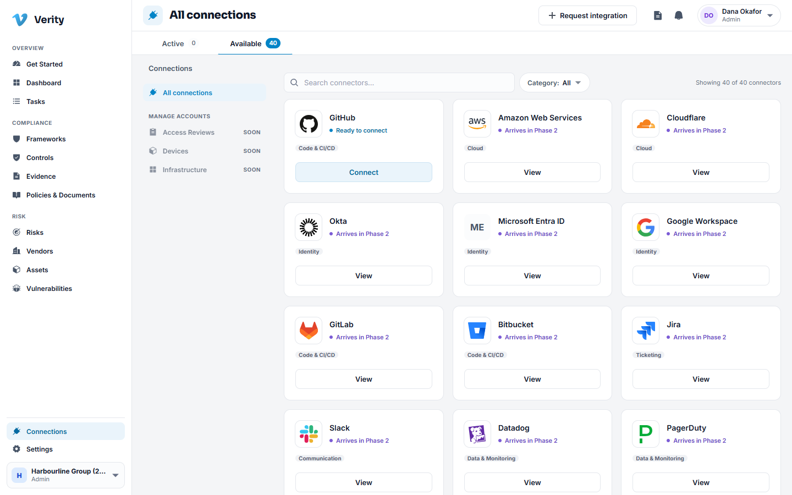
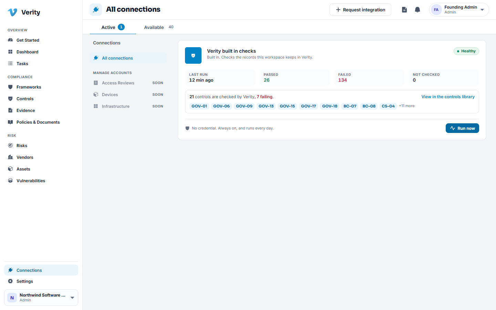
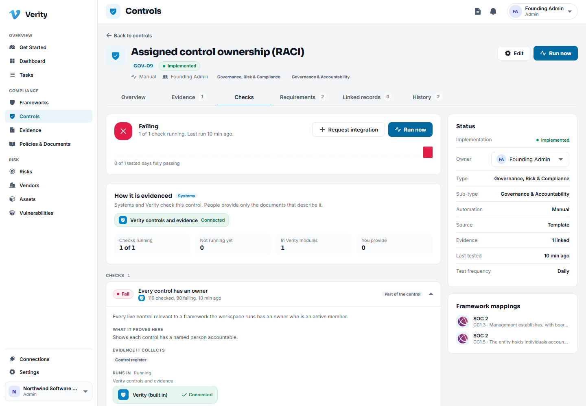
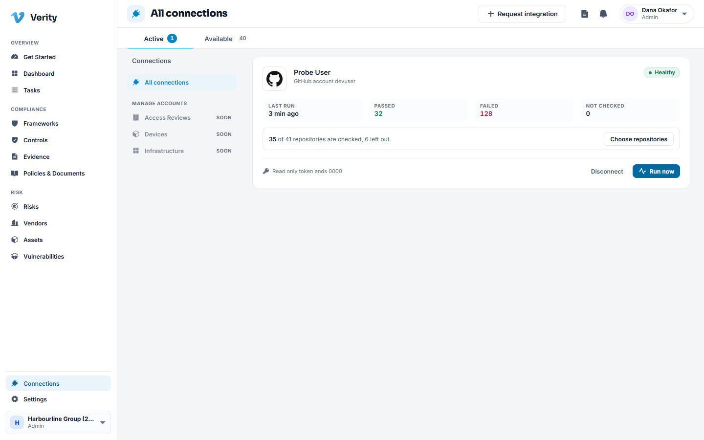
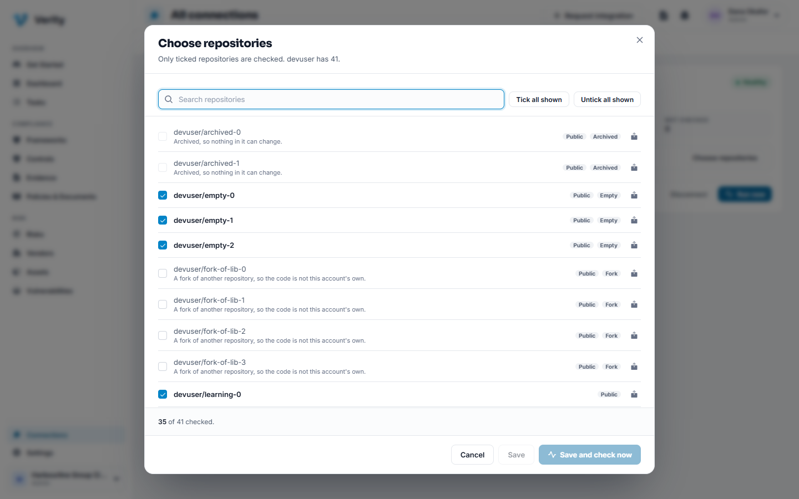
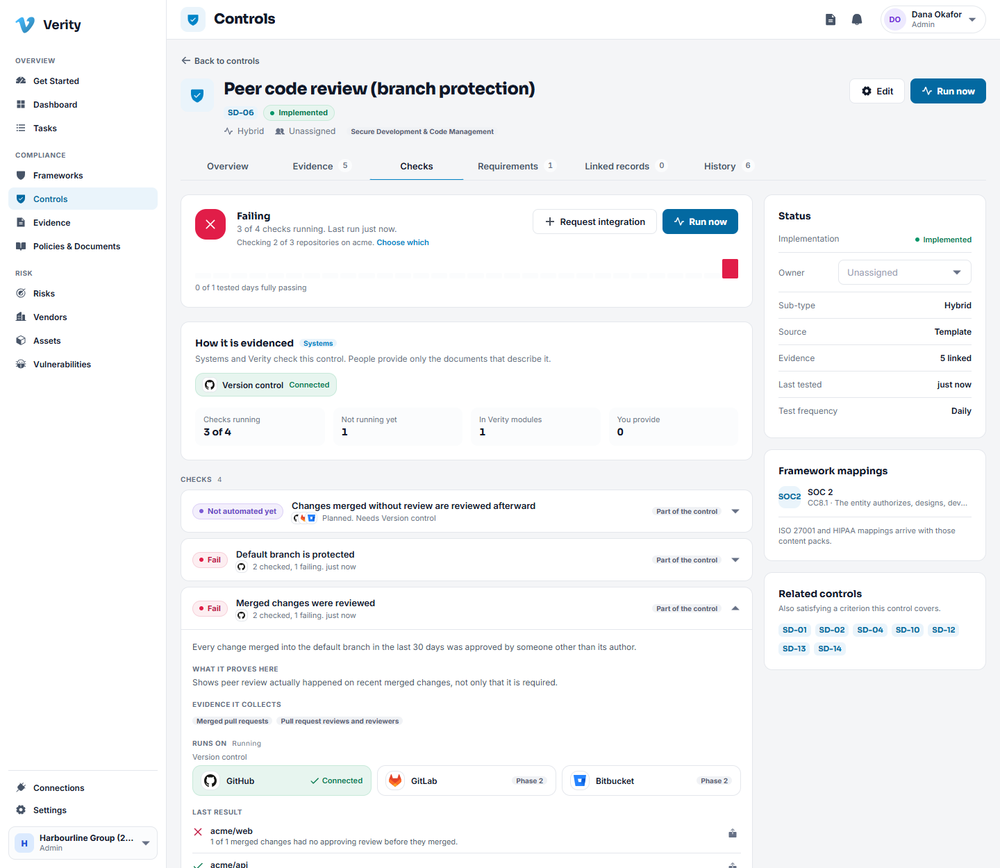
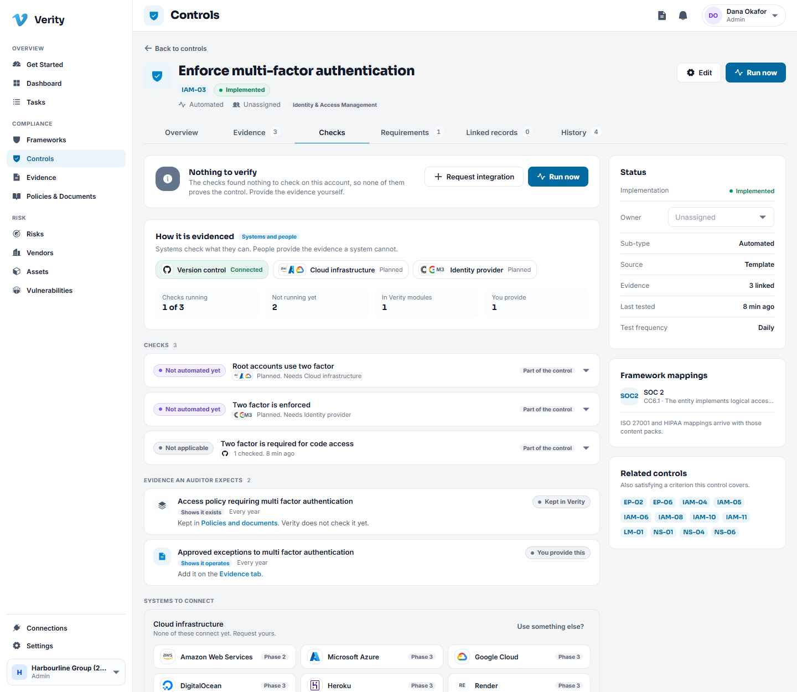

# 11. Connections

## What a connection does

A connection lets Verity check a system for you, on a schedule, and attach what it
finds to the controls those checks answer. Instead of somebody screenshotting a
setting every quarter, the setting is read every day and the evidence appears on its
own.

## What is available today

Two things run today.

- **Verity built in checks** check the records you already keep in Verity. Every
  workspace has them, with nothing to set up.
- **GitHub** is the first live connector to an outside system.

Later phases add identity providers, cloud accounts, device management and ticketing.
Anything marked **Soon** on this page is not connected to real data yet.

You can register interest in a system that is not there yet using the request
option. It records what you need so it can be prioritised.

## Verity's built in checks

Verity checks the records your workspace already keeps in Verity, every day, the same
way the GitHub connector checks repositories. An asset nobody owns, a vendor review that
slipped, a policy past its review date: each shows up as a failed check on the controls
it serves.

- **Always on.** Every workspace has a **Verity built in checks** card on **Connections**,
  under **Active**.
- **No credential.** There is nothing to connect, and it cannot be disconnected.
- **Runs daily.** **Run now** on the card runs it straight away. A new workspace gets
  its daily schedule within an hour.
- **Files evidence.** Each run files a report as evidence on the controls each check
  serves. It is titled with the check's name, then "Verity check" and the date in UTC,
  and it lists the population the check looked at.
- **Can stop a control being ready.** An implemented control whose Verity check fails is
  not counted as ready. As with every check, automation can only take readiness away,
  never grant it. Reports Verity files itself never count as the evidence a check is
  judging, so no check can pass on its own output.

Each check gives a result for each record it looks at: **Passed**, **Failed** or **Not
applicable**. **Could not check** appears only when the run itself failed.

### What the built in checks look at

There are 30 checks. Here is what passes, by the area whose records they read.

- **Assets.** Every asset in service has an owner who is an active member, is
  classified, and was reviewed within the window its criticality sets. An asset taken
  out of service has a disposal record and, for infrastructure, data and cloud assets,
  wiped storage or physical destruction.
- **Vulnerabilities.** No open critical or high finding is past its SLA without a risk
  acceptance in force. Known exploited findings have an owner who is an active member.
- **Risks.** Open risks have a next review date that has not passed. Risks outside
  appetite are owned and treated. Risks treated by mitigation link to a control.
  Accepted risks have an acceptance in force. Every active register's open risks were
  scored and assessed in the last 12 months, and a register with no assessment at all
  fails.
- **Vendors.** Vendors have an owner and a tier. Critical and high engagements were
  reviewed within their tier's cadence and have a reassessment booked. Approved vendors
  holding personal data have a data processing agreement in force, with a copy
  attached.
- **Documents.** Required documents, meaning those started from a template or linked to
  a control, are published, approved in the last 12 months, within their review date,
  and have no placeholders left. Everyone asked to acknowledge a document has signed
  its current version or still has time to, and nobody past the due date is unsigned;
  a late signature counts. The code of conduct and acceptable use policy bind
  all staff: every active member who is not a guest auditor must have signed the
  current version or been asked to. Published documents are owned, approved for their
  current text in the last 12 months, and kept under review.
- **ISO management system documents.** A current scope statement, context register,
  interested parties register, security objectives, communication plan and competence
  procedure. Each passes when a document started from the matching template, or linked
  to the control, is in force.
- **Tasks.** Remediation tasks linked to a control, a vulnerability or a risk keep to
  their SLA or due date. Blocking a task pauses its SLA, not its due date.
- **Controls.** Every live control of a framework you run has an owner who is an active
  member. Implemented controls have evidence that has not expired and was not rejected.
  Evidence with no renewal date counts for 12 months from collection. An internal audit
  and a management review were filed as evidence, by a person, on GOV-13 and GOV-15 in
  the last 12 months; a policy or procedure document does not count. This applies in
  every workspace.
- **ISO 27001.** Every Annex A decision was reviewed in the last 12 months, with its
  reason. The management system scope is recorded.

### Reading a failed built in check

Open the control and go to its **Checks** tab. A Verity check sits there beside any other
check on the control.

1. Read which check failed. Each result is about one record, such as one asset or one
   vendor.
2. Open the report it filed on the **Evidence** tab to see the population it looked at.
3. Fix the record in its own module: give the asset an owner, book the vendor
   reassessment, publish the reviewed policy. Nothing is fixed on the Connections page.
4. Wait for the next daily run, or use **Run now** on the card to check again.

**Could not check** says nothing about your records. It means the run failed. Use **Run
now** to try again.

> **An internal audit or management review must come from a person.** Verity's own
> reports never count. File the internal audit report on control GOV-13 and the
> management review minutes on GOV-15. The check only sees that a person filed evidence
> on that control in the last 12 months. It cannot tell an audit report from any other
> file, so file the record itself: what was audited or reviewed, who did it, when, the
> findings or decisions, and who they were reported to. A readiness assessment or the
> procedure document is not an internal audit.

## Walkthrough: connect GitHub

1. Go to **Connections** and choose **Connect** on GitHub.
2. Give the connection a name, for example "GitHub, engineering org".
3. Paste a personal access token with read access to the organisation you want
   checked. Read only is enough, and read only is what you should use.
4. Save. Verity encrypts the credential before it is stored, and it never appears in
   a log or on a screen again.
5. The first run starts right away. After that it runs on a schedule.
6. **Choose which repositories count.** Read the next section before you rely on the
   result: by default Verity checks everything the token can see.

> **Use a token that can only read.** Nothing in Verity needs to write to your
> source control, and a read only token limits what a mistake can cost.

## Choosing which repositories are checked

A token reaches every repository its owner can read. For an organisation that is mostly
the product. For a personal account it is also every fork and every piece of coursework,
and judging all of those fills the control page with failures nobody can act on and no
auditor will ask about. A SOC 2 audit covers named systems, so you say which.

The card tells you what is being judged: "35 of 41 repositories are checked, 6 left out".
Without doing anything, archived repositories and forks are left out and say why.

### Walkthrough: choose the repositories

1. Open **Connections**, go to the **Active** tab, and click **Choose repositories** on
   the connection.
2. Tick the repositories that are part of the system under audit. Untick the rest. Use the
   search box and **Tick all shown** or **Untick all shown** to work in bulk.
3. If you left any out, give one reason. It applies to every repository you untick in this
   save, so forty sandbox repositories need one sentence, not forty.
4. Click **Save and check now**, or **Save** to wait for the next scheduled run.

> **A reason is required, and it is printed on the evidence.** Each repository you leave out
> keeps its reason and who decided it, the decision is written to the audit log, and every
> evidence file lists what was not checked. An auditor reading a clean result can then see the
> population it was clean over. Your decision stays until you change it: a run never
> overwrites it. Archived repositories are always left out, because nothing in them can
> change.

Repositories with no commits yet show an **Empty** badge. They stay in scope but have nothing
to check, so their results read **Not applicable** rather than failing.

## What the checks look at

The GitHub connector answers questions a SOC 2 auditor asks about how software gets
built and released, for example:

- is two factor authentication required for the organisation,
- are branch protection rules in place on the default branch,
- are pull requests reviewed before merge, by someone other than the author, and before
  the merge happened,
- who has administrative access,
- are secret scanning and dependency alerts switched on.

Each check maps to the controls it can support.

## Reading the results

Open a control and go to its **Checks** tab.

- **Passing** means at least one test ran and found what the control claims, and none failed.
- **Failing** means a test ran on a repository in scope and found something else. The detail
  says which repository and what to change.
- **Could not check** means Verity could not read the setting: the token expired, lacks a
  permission, or GitHub was unreachable. It is never shown as a failure, because it says
  nothing about the control.
- **Out of date** means the last check is more than two days old, for example because a
  token expired or a run did not happen. It replaces Passing and Failing alike, because
  nothing known is current, and it blocks readiness until the checks run again.
- **Nothing to verify** means every test found nothing to check. A personal account cannot
  require two factor for other people, for example, so the two factor control is verified by
  nothing and must be evidenced manually. This is deliberately not shown as "Passing".

A line under the status says how much was checked: "Checking 35 of 41 repositories on
devuser", with a link to change it. It appears on controls that have repository level tests.

The output is attached to the control as evidence, dated, so the control's evidence
list fills without anybody uploading anything. Each check files its own evidence, linked only to
the controls that check supports, so SD-11 holds the secret scanning result and nothing about
branch protection. It is named for the check, the account and the moment it was collected, for
example "Secret scanning is on: GitHub devuser, 6 Oct 2026 14:05 UTC", and opens as a report:
what was checked, each repository left out with its reason, and what the check found. **Show the
raw file** is one click away, and **Download JSON** saves the original, which is what is stored.
A check files again at most once a day unless its result changes, so a passing check does not
bury the record in identical copies; on the control, the newest result is the row and the
earlier ones sit under **earlier results**. In the evidence library the same earlier results
are folded away until you ask for them. A failing run is
filed too, because it is the dated record of what was observed, but it never makes a failing
control look ready: readiness looks at the tests as well as the evidence. A result reads
**Current** when it is filed and **Aging** in the last two days of its week, by which time the
next run has normally replaced it.

### When the plan, not the setting, is the problem

GitHub offers branch protection and secret scanning on private repositories only to paid
plans, so a personal account on Free cannot meet them there. Verity tells this apart from a
missing permission. The result is a failure, because the control's aim is not being met, but
it is said once for the account instead of on every repository: "30 repositories on devuser
cannot be checked on the current GitHub plan". Your options are to move the owning account to a
paid plan, to make a repository public if it can be, or to leave the repositories out with a
reason. **Leave these out** opens the repository list with them already unticked, asks for the
reason, and checks again. It does not tell you to grant a permission your token already has,
and it does not ask you to turn on a setting the plan does not have.

### Which controls a connection checks

Each connection card on the Connections page lists the controls it checks, failing ones first,
with a link into the controls library. In the library, **Evidenced by** filters by how a control
is evidenced (systems, systems and people, people), and **System** then narrows to the controls
one system checks. **System** is hidden when only **People** is chosen, because no system
checks those.

### What "protected" means

The default branch counts as protected when changes can reach it only through review: a pull
request is required, pushes are restricted to named people or teams, or the branch is locked.
Protection that only stops deletion or force pushes does not count, because anyone with write
access can still push straight to the branch.

## When a connection breaks

A connection whose token has expired or whose permissions were reduced shows as
unhealthy on the Connections page with the reason. The checks stop rather than
quietly report a pass. Reconnect with a fresh token and the schedule resumes.

---

Next: [Settings and administration](12-settings-and-administration.md)
