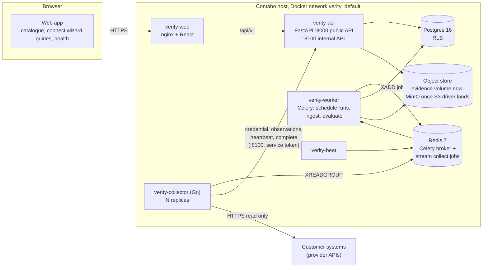

# Design: the connection platform and the Go collector runtime

Work packages F4 and F5 of `docs/product/evidence-connectors/04-phases-and-work-packages.md`, plus their
build and deployment on the production server. A plan; nothing here is built. Decision record:
`docs/adr/0016-go-collectors-beside-the-python-core.md`. Model: `docs/product/evidence-connectors/
01-evidence-model.md` (sections 1.4 and 1.5) and `02-integration-model.md`.

## 0. Where it starts from

| Today | Where |
|---|---|
| One provider connector (GitHub, Python) that collects (`github.collect`) and judges (result functions) separately, inside the Celery worker | `backend/src/verity/modules/connectors/` |
| Connections with envelope encrypted credentials (additional data binds tenant and connection), resources and scope, runs, results, health | `connections`, `connection_resources`, `check_runs`, `check_results` |
| Shared HTTP client with timeout, backoff with jitter, paging and one error vocabulary | `connectors/http.py` |
| Daily Celery job `run_connector_checks`, one workspace at a time | `workers/tasks.py` |
| A hard coded catalogue of 40 integrations and one connect dialog (GitHub) | `frontend/src/features/connectors/` |
| Production: Docker Compose on a shared Contabo host, images built on the server by `deploy.sh`, no published ports, edge proxy joins `verity_default`; Postgres 16, Redis 7 (append only), MinIO (but evidence still on the `evidence-data` volume, the S3 driver is a stub) | `infra/docker/docker-compose.prod.yml`, `infra/scripts/deploy.sh` |

## 1. Components



| Component | Owns | Never does |
|---|---|---|
| Web | Catalogue, before you connect screen, connect wizard per credential pattern, guide panel, test results, scope, health, disconnect | Holds a secret after the form posts |
| API, public (:8000) | Connection endpoints, OAuth starts and callbacks, provider content, test requests | Exposes the internal API |
| API, internal (:8100) | Credential hand out, observation ingestion, heartbeat, completion; tenant bound per call | Accepts a request without a valid collector token |
| Worker (Celery) | Due connections, creating runs and leases, enqueueing jobs, ingest finalisation, evaluation of checks, evidence files, outcome refresh | Calls provider APIs for Go providers |
| Collector (Go) | Provider auth, paging, rate limits, normalisation, completeness, telemetry | Touches the database, evaluates checks, logs secrets |
| Redis | `collect:jobs` stream with consumer group `collectors`; Celery as today | Holds credentials |

## 2. How the parts talk

| From | To | Channel | Auth | Payload |
|---|---|---|---|---|
| Worker | Collector | Redis Stream `collect:jobs` (`XADD`, consumer group, `XACK`, `XAUTOCLAIM` after the lease time) | Redis on the private network | Job (2.1), no secrets |
| Collector | API internal | `POST /internal/v1/runs/{run_id}/credential` | Service token (2.4) | Returns the access material for this run (2.2) |
| Collector | API internal | `POST /internal/v1/runs/{run_id}/observations` | Service token | Gzipped NDJSON batch with a sequence number (2.3) |
| Collector | API internal | `POST /internal/v1/runs/{run_id}/heartbeat` every 30 s | Service token | Progress; extends the lease |
| Collector | API internal | `POST /internal/v1/runs/{run_id}/complete` | Service token | Manifest: per type count and completeness, API calls, throttles, error classes, collector version |
| API | Worker | Celery task `finalise_run(run_id)` | Celery | Evaluate, file evidence, refresh outcomes |
| Collector | Provider | HTTPS | The run's credential | Read only calls |

### 2.1 Job

```json
{
  "schema": "verity.collect.job/v1",
  "job_id": "uuid", "run_id": "uuid", "tenant_id": "uuid", "connection_id": "uuid",
  "provider": "entra", "pattern": "customer_app_registration",
  "observation_types": ["identity.user", "identity.policy"],
  "scope": {"include": ["..."], "exclude": ["..."]},
  "window": {"since": "2026-11-23T00:00:00Z", "until": "2026-11-24T00:00:00Z"},
  "kind": "collect | probe | inventory",
  "deadline": "2026-11-24T00:30:00Z", "attempt": 1
}
```

`probe` answers the Test step (which checks can run with the granted permissions); `inventory` lists
resources for the scope dialog; `collect` is the scheduled run.

### 2.2 Credentials

The core decrypts with the existing envelope scheme and returns only what the run needs, valid until
the job deadline, over the private network:

| Pattern | What the collector receives |
|---|---|
| Vendor app, admin consent | An access token the core obtained with Verity's own credential for that tenant (refreshed by the core) |
| Customer app registration (Entra, Okta, Google delegation) | A token minted by the core from the customer's key material, or, where the provider needs the collector to sign, a signing request answered by the core's key service; the private key never leaves the core |
| API token or key | The token itself (no alternative exists); kept in memory only, dropped at the end of the run |
| Cloud role | Role ARN and external id; the collector assumes the role with Verity's vendor identity, which lives in the collector's own secret file (decision G16) |

### 2.3 Observations

NDJSON, one observation per line, at most 5 MB per gzipped batch; the API validates each line against
the schema of its type and version, binds tenant and connection from the run (never from the payload),
stores the raw batch in the object store (evidence and replay) and upserts parsed rows into
`observations`. A batch is idempotent on `(run_id, seq)`. Lines that fail validation are counted and the
type's completeness becomes `invalid_data`, never silently dropped.

### 2.4 Service token

Each collector replica holds an Ed25519 private key (a file mounted from the host, not in the image);
it signs a short JWT (audience `verity-internal`, subject the collector id, 5 minute expiry) per call;
the API holds the public keys of allowed collectors. The internal port is bound only on the Docker
network and the web container never proxies to it.

## 3. Data (core migrations, each with RLS in the same migration)

| Change | Purpose |
|---|---|
| `check_runs`: `executor` (python, go), `lease_expires_at`, `collector_id`, `manifest` (JSONB), `job_id` | Leases, telemetry, which runtime ran it |
| New `observations` (tenant owned): `run_id`, `connection_id`, `type`, `schema_version`, `external_id`, `attributes` JSONB, `observed_at`, `source_ref`; unique `(tenant_id, run_id, type, external_id)`; index `(tenant_id, connection_id, type, observed_at)` | What checks evaluate; the last complete run per type is "current" |
| New `observation_batches` (tenant owned): `run_id`, `seq`, `object_key`, `lines`, `invalid` | Idempotency and raw evidence pointer |
| Retention: keep observations of the last 7 runs per connection plus every run referenced by filed evidence; raw batches follow the evidence retention setting | Bounded growth on a small host |
| Provider content (global, sealed): `seed/content/integrations/providers/*.json` and `guides/*.md` | Catalogue, fields, permissions, guides (02 section 2.5) |
| `tenant_sso.connection_id` | One card for sign in and evidence |
| External id per workspace for cloud roles: `connections.external_id_salt` or a workspace setting | AWS and Azure trust |

## 4. The connection platform (F4)

Backend (`modules/connectors`, staying inside its layering):

- Provider content loader and seal check; `GET /integrations` (catalogue with state per workspace),
  `GET /integrations/{provider}` (before you connect: permissions with purpose and checks, requirements,
  guide).
- `POST /connections` validates the body against the provider's field schema for its pattern; secrets
  are encrypted before insert and never echoed (rule 8); audit row.
- OAuth patterns: `/integrations/{provider}/oauth/start` and `/callback`, state and PKCE in Redis (the
  single sign on code already does this), tenant bound on return.
- Cloud role: per workspace external id, a template link (CloudFormation for AWS), then role ARN.
- `POST /connections/{id}/test` enqueues a `probe` job and returns per check readiness when it lands.
- Health: last and next run, per capability state, completeness per type, error in plain words with the
  fix, credential expiry; reminders through Notifications 30 and 7 days before expiry.
- Customer supplied URLs (self managed GitLab, discovery documents, SAML metadata) pass an outbound
  guard: HTTPS only, no private, loopback or link local addresses unless an operator allowlists them.

Frontend (`features/connectors`):

- Catalogue from the API (retire `connector-catalogue.ts`), grouped by category, capability chips, state.
- Wizard generated from the provider's pattern: consent button, field form, cloud role steps; the guide
  in a side panel; the Test step showing which checks will run.
- Health page and the existing scope dialog for every resource type.
- One card per provider joining sign in (Settings, Security, SSO) and evidence.

Done when GitHub runs through the new catalogue and wizard with no change in behaviour, and adding a
second provider needs content only for its screens.

## 5. The Go collector runtime (F5)

### 5.1 Repository layout

```
collectors/
  go.mod                     module verity/collectors (Go version pinned)
  cmd/collector/main.go      run | health | version | probe-fixture
  internal/queue/            Redis Streams consumer (github.com/redis/go-redis/v9)
  internal/coreapi/          client for the internal API, retries, idempotent batches
  internal/svctoken/         Ed25519 JWT signing
  internal/runtime/          job lifecycle, lease heartbeat, deadlines (context), worker pool
  internal/limit/            per provider and per connection limiters (golang.org/x/time/rate), Retry-After
  internal/httpx/            outbound client: timeouts, TLS, egress guard, paging helpers, error classes
  internal/contracts/        generated from ../contracts/*.schema.json (do not edit)
  internal/telemetry/        log/slog JSON with key based redaction, counters
  providers/<name>/          Provider interface implementations
  fixtures/<name>/           recorded HTTP cassettes (go-vcr), secrets scrubbed
contracts/                   JSON Schemas for jobs and observation types (shared with Python)
```

### 5.2 The provider interface

```go
type Provider interface {
    Key() string                                   // "entra"
    ObservationTypes() []string                    // what it can emit
    Probe(ctx context.Context, c Credential) ([]PermissionResult, error)
    Inventory(ctx context.Context, c Credential, s Sink) error
    Collect(ctx context.Context, j Job, c Credential, s Sink) error
}
```

`Sink` batches observations, assigns sequence numbers, posts them, and records completeness per type
(`complete`, `truncated`, `permission_missing`, `unsupported_by_plan`, `invalid_data`). A provider never
decides pass or fail.

### 5.3 Behaviour

- **Concurrency:** a pool of workers per container (setting, default 4); one run per connection,
  guaranteed by the core's lease; a provider limiter shared by all runs on the replica.
- **Deadlines:** each job has a deadline; on expiry the run completes with `truncated` for the types
  not finished, never waits forever.
- **Retries:** transient errors retried with backoff and jitter (same policy as `connectors/http.py`);
  auth and permission errors are not retried; a crashed replica's job is reclaimed by another after the
  lease (`XAUTOCLAIM`); a retried job replaces its own batches.
- **Errors:** auth, permission, plan, rate_limited, transient, provider_bug; mapped to the plain words
  the health page shows.
- **Logging:** structured JSON, run id as correlation id, a redaction list (authorization, token,
  secret, password, key, cookie); never response bodies.
- **Supply chain:** dependencies pinned in `go.sum`; `govulncheck`, `golangci-lint`, race detector and
  tests in CI; official provider SDKs only where the connector documents name them.

### 5.4 Testing

| Level | What |
|---|---|
| Unit | Normalisation per provider on recorded fixtures: pass data, empty, truncated, permission missing, plan limited |
| Contract | Every emitted observation validates against its schema; Python and Go generated types agree (CI job) |
| Integration (local) | Compose with Redis, the API and one collector; a fake provider server; a job flows from schedule to objective outcome |
| Isolation | A job for tenant A cannot write observations for tenant B (the token, the run and the tenant must agree); the app role, not the owner |
| Parity | GitHub in Go against the same fixtures as the Python collector: identical observations and identical check results |
| Live | A developer or trial account per provider before release; results compared by hand with the provider's console |

## 6. Images and deployment

### 6.1 The collector image

```dockerfile
# collectors/Dockerfile (outline)
FROM golang:<pinned> AS build
WORKDIR /src
COPY collectors/go.mod collectors/go.sum ./
RUN go mod download
COPY collectors/ ./
COPY contracts/ /contracts/
ARG VERITY_VERSION=dev
RUN CGO_ENABLED=0 go build -trimpath -ldflags "-s -w -X main.version=${VERITY_VERSION}" -o /out/collector ./cmd/collector

FROM gcr.io/distroless/static-debian12:nonroot
COPY --from=build /out/collector /collector
USER nonroot
ENTRYPOINT ["/collector", "run"]
```

Small (a static binary plus CA certificates), no shell, non root.

### 6.2 Compose service

```yaml
  collector:
    build:
      context: ../..
      dockerfile: collectors/Dockerfile
      args: { VERITY_VERSION: "${VERITY_VERSION:-dev}" }
    image: verity-collector:${VERITY_VERSION:-latest}
    container_name: verity-collector
    env_file: [ .env.collector ]          # only what a collector needs (6.3)
    volumes:
      - ./secrets/collector:/run/secrets/collector:ro
    read_only: true
    tmpfs: [ /tmp ]
    security_opt: [ "no-new-privileges:true" ]
    cap_drop: [ ALL ]
    mem_limit: 512m
    cpus: 1.0
    depends_on:
      redis: { condition: service_healthy }
      api: { condition: service_started }
    healthcheck:
      test: ["CMD", "/collector", "health"]
      interval: 30s
    restart: unless-stopped
```

The API service gains the internal port on the Docker network only (no `ports:`), and the web
container's nginx keeps proxying only `/api/` to port 8000.

### 6.3 Configuration and secrets

| File on the host | Holds | Read by |
|---|---|---|
| `infra/docker/.env.production` (exists) | Adds `COLLECTOR_PUBLIC_KEYS` (allowed collector keys), `COLLECTOR_ENABLED`, the internal port | api, worker, beat |
| `infra/docker/.env.collector` (new, git ignored, from an example file) | `REDIS_URL`, `CORE_INTERNAL_URL=http://verity-api:8100`, `COLLECTOR_ID`, worker count, log level; no database URL, no encryption key | collector |
| `infra/docker/secrets/collector/` (new, git ignored, mode 600) | The collector's Ed25519 private key; Verity's vendor identities when decided (AWS key or token issuer key) | collector |

The owner creates these by hand on the server from the example files and a one line key generation
command in the runbook; nothing secret is committed or pasted into chat.

### 6.4 Build and release

- **Now:** `deploy.sh` already runs `$DC build`, which builds every service with a `build:` section, so
  the collector image is built on the server like the others. Go builds are quick and the image small.
- **Deploy order** (unchanged, plus one check): back up, build, migrate, swap containers, load content,
  then readiness: the API `readyz`, the worker and beat staying up, and now `collector health` and the
  `collect:jobs` consumer group having a live consumer.
- **Switch on gradually:** `COLLECTOR_ENABLED=false` ships the container idle; then on for the probe of
  one internal test connection; then for the pilot provider; GitHub stays on Python until parity.
- **Rollback:** as today (check out the earlier commit, build, up). A disabled collector leaves runs on
  the Python path or queued; nothing is lost because jobs wait in the stream.
- **Later (decision):** build images in CI and push them to a registry (GitLab's container registry, since
  GitLab is the main repository), so the server only pulls signed, scanned images.

### 6.5 Operations

- Logs through `docker logs verity-collector` (JSON); a runbook page with the queries that matter (a
  run's id, a provider's throttles).
- Health page in the product shows per connection lag and errors; a stuck stream (pending entries older
  than the lease) raises a notification to platform admins.
- Resource use on the shared host: memory 512 MB and one CPU caps the collector; the worker count is
  raised only after measuring.
- Egress: provider calls leave from the server's public address; customers who must allowlist (self
  managed GitLab, Jira Data Center) are given that address in the setup guide.
- Backups: unchanged (Postgres and the evidence volume); raw observation batches live with evidence.

## 7. Security

| Threat | Answer |
|---|---|
| Internet reaches the internal API | Separate port, no published ports, web proxy never forwards it, service token required |
| A collector writes into another tenant | Tenant and connection come from the run row; the token's collector id must hold the run's lease; RLS on insert; isolation test |
| Secret leaks through logs or jobs | Jobs carry no secrets; credentials only through the internal API, in memory, redacted logging |
| Customer supplied URL used for SSRF | Egress guard in Go and in Python for every customer URL |
| Compromised collector image | Distroless, non root, read only, no capabilities; dependencies scanned; no database or encryption key in its environment |
| One vendor credential reads many customers | Stored only in the collector secret folder, rotated, use logged per tenant; the Entra multi tenant app waits for a key service (decision G13) |
| Replay of an observation batch | Idempotent on `(run_id, seq)`; batches after `complete` rejected |

## 8. Migration path

1. **F4a** Provider content, catalogue and wizard on the existing Python GitHub path.
2. **F5a** Contracts, internal API, `observations` tables, runs with leases; the Go runtime with a
   built in `fake` provider; local compose flow end to end.
3. **F5b** Deploy the collector container disabled; enable for a probe against an internal test account.
4. **F5c** Port GitHub to Go behind the parity test; run both in shadow for two weeks (Go results stored,
   Python results shown); switch when identical.
5. **C1** The pilot's identity provider as the first new Go provider.
6. Retire the Python GitHub collector.

## 9. Who to tell what

| Who | When | What (short, plain) |
|---|---|---|
| The colleague who owns the shared server | Before F5b | "One more small container for Verity, capped at 512 MB and one CPU, making outbound HTTPS calls to SaaS APIs on a schedule. No new ports." |
| The client (Infowise) | Before F5b | The connector runtime goes in idle first; GitHub keeps working as now; nothing changes for users until a provider is switched on |
| Pilot customer | Before C1 | The permissions requested and why, the setup guide, the server address to allowlist if needed, how to revoke access |
| Developers and agents | Each package | This design, ADR-0016, the connector document of the provider, the definition of done in 04 |

## 10. Decisions for the owner

| # | Decision | Recommendation |
|---|---|---|
| R1 | Accept ADR-0016 (Go collectors, Python evaluation, Redis Streams, internal API) | Accept |
| R2 | Observations in Postgres with raw batches in the object store, versus files only | Postgres plus raw batches; finish the S3 driver (MinIO is already running) before observation volume grows |
| R3 | Build images on the server (as today) or in CI with a registry | On the server now; CI and GitLab registry after the first Go provider ships |
| R4 | Collector resources on the shared host | 512 MB, one CPU, 4 workers; revisit after measuring |
| R5 | A staging environment | A second compose project on a separate small server, or local compose only until the first customer connector; the shared host is not a place to test |
| R6 | Vendor secrets | Files in `infra/docker/secrets/` now; a managed key service before Verity holds a credential that reads many customers |
