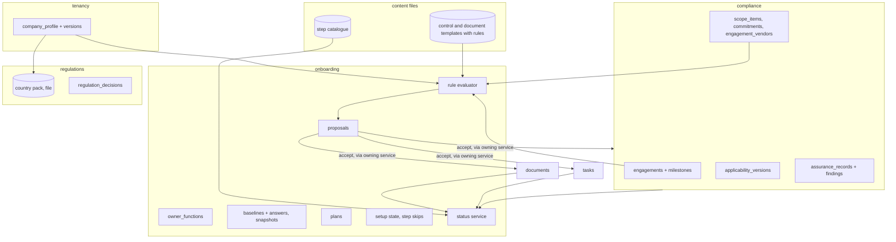

# Design: guided onboarding

Read `proposal.md` first. Product behaviour is in `docs/product/guided-onboarding/`. This file says
how it is built. Table and column names are proposals: confirm each against the current models
before writing a migration, and keep what already exists.

## 1. Shape



Principles:

- The onboarding module owns suggestions, baselines, plans and status. It owns no compliance
  record. Every change to a control, applicability decision, document or task goes through that
  module's service (PL-3).
- Content that never changes per workspace stays in sealed files read at start. No new global
  table.
- Existing tables are extended before new ones are added.

## 2. Data model

All new tables are tenant owned: `tenant_id` first in every composite index, forced row level
security in the same migration, UUIDv7 keys, people as `tenant_memberships` references, timestamps,
no hard delete.

### 2.1 Profile (module `tenancy`)

`company_profile`, existing, gains:

| Column | Type | Note |
|---|---|---|
| `registered_address` | text, null | Document variable |
| `answers` | JSONB, not null, default `{}` | Typed answers of part 2 section 2.1, validated by a Pydantic model. A CHECK keeps it an object |
| `answers_schema` | int, not null, default 1 | Version of the answer model |
| `status` | text: `draft`, `confirmed` | |
| `version` | int, not null, default 0 | 0 until first confirmation |
| `confirmed_by_membership_id`, `confirmed_at` | FK, timestamp, null | |

`company_profile_versions`, new, append only (revoked grant and trigger): `tenant_id`, `version`,
`answers`, `details` (the legal fields as they were), `confirmed_by_membership_id`, `confirmed_at`.
Unique on `(tenant_id, version)`. Built in migration 3b03e4d1a72c. Editing a confirmed profile
sets it back to draft; confirming writes version n+1 and an `approve` audit row.

Why JSONB for answers: about 35 facts, half of them lists, read by a rule evaluator by key and
never filtered across workspaces. Typed columns would mean a migration per question. The existing
custom fields primitive already keeps values in a JSONB column with definitions in code. The
legal identity fields stay as columns because documents and the provider console read them.

The free text columns `industry`, `company_size`, `headquarters` and `regulatory_scope` stay,
read only, until a data migration maps what it can into `answers`. Values that do not map are
shown to the admin as "From your earlier profile" when the question is asked.

Countries are stored as ISO 3166-1 two letter codes. Region groups use reserved codes (`EU`, `EEA`,
`GCC`, `WORLD`). Zones are `{country: "AE", zone: "difc"}`.

### 2.2 Engagements (module `compliance`)

`engagements`, existing, gains:

| Column | Type | Note |
|---|---|---|
| `cycle_label` | text | "2027 Type 2", "Initial certification" |
| `is_current` | bool | Partial unique index on `(tenant_id, framework_version_id)` where true. Replaces the rule of one row per workspace and framework version |
| `driver` | text, null | Who asked |
| `target_date`, `as_of_date`, `live_date` | date, null | Type 1 date, management system live date |
| `assessor_name` | text, null | CPA firm or certification body. Backfilled from `certification_body` |
| `assessor_accreditation_body` | text, null | ISO only |
| `assessor_contact_name`, `assessor_contact_email` | text, null | |
| `assessor_state` | text: `undecided`, `chosen` | |
| `assessor_engaged_on` | date, null | Letter or contract date |
| `sponsor_membership_id`, `signer_membership_id` | FK, null | |
| `scope_document_id`, `description_document_id` | uuid, null | Ids of documents, resolved through the documents service |
| `applicability_version_id` | FK, null | ISO: the approved version this engagement refers to |

`status` takes the values planning, in progress, completed, closed. The service rule that empties
`scope_statement`, `certification_body` and `audit_on` for SOC 2 is removed (EN-3, SC-1).

`engagement_milestones`, new: `engagement_id`, `kind` (from a fixed list per framework), `label`,
`planned_on`, `actual_on`, `to_be_agreed` bool, `sort`. Unique on
`(tenant_id, engagement_id, kind, sort)`.

Changes in the period (EN-5) need no table: the reason is stored on the audit row of the change,
and the list is a read of audit rows for the engagement's scope objects between the period dates.

### 2.3 Scope (module `compliance`)

| Table | Columns | Rules |
|---|---|---|
| `scope_items` | Workspace wide, shared by every framework (D-6): `kind` (service, legal_entity, site, environment, system, vendor, people_group, data_type), `name`, `ref_type`, `ref_id`, `origin` (manual, suggested), `source`, `external_id`, `synced_at`, `retired_at`, `retired_reason` | Unique on `(tenant_id, ref_type, ref_id)` where `ref_id` is set, and on `(tenant_id, source, external_id)` |
| `scope_decisions` (built with `scope_items`, migration af53b58da5b3) | `scope_item_id`, `engagement_id`, `in_scope`, `reason`, `decided_by_membership_id`, `decided_at` | One row per item per engagement: in or out is never shared between frameworks. CHECK: reason required when out. Unique on `(tenant_id, scope_item_id, engagement_id)`. A change after a SOC 2 Type 2 period starts is listed under changes in the period; a change to an ISO decision raises a prompt to tell the certification body. Rules from `research_notes/Guided onboarding plan/shared_scope_check.md` |
| `commitments` | `statement`, `source_kind` (contract, service_levels, privacy_notice, website, other), `source_ref`, `points_at` JSONB (category codes or requirement keys), `owner_membership_id`, `status` (active, retired), `retired_reason` | Workspace wide, read by every engagement |
| `engagement_vendors` | `engagement_id`, `vendor_id`, `role` (subservice, supplier), `method` (carve_out, included, null), `note` | Unique on `(tenant_id, engagement_id, vendor_id)`. Vendor read through the vendors service |
| `applicability_versions` | `tenant_framework_id`, `version`, `status` (draft, approved), `snapshot` JSONB, `prepared_by_membership_id`, `approved_by_membership_id`, `approved_at` | Approved rows are never updated. Unique on `(tenant_id, tenant_framework_id, version)` |

The working applicability stays in the existing `requirement_applicability`. A version is a frozen
copy of it. The asset tag list `compliance_scope` is left in place and read only in the interface
once scope items exist (SC-4).

### 2.4 Assurance records (module `compliance`)

| Table | Columns |
|---|---|
| `assurance_records` | `engagement_id`, `kind` (internal_audit, management_review, external_stage), `label`, `starts_on`, `ends_on`, `performed_by_membership_id`, `performed_by_name`, `performed_by_firm`, `independence_confirmed_by_membership_id`, `scope_note`, `document_id`, `inputs` JSONB (review checklist), `status` (planned, held, closed) |
| `assurance_findings` | `record_id`, `grade` (major, minor, observation, exception), `summary`, `due_on`, `owner_membership_id`, `response`, `task_id`, `closed_on`, `closure_evidence_id`, `verified_on` |

A finding creates a task through the tasks service, keyed on `(source="assurance",
external_id=<finding id>)`, the same pattern as evidence renewals. The task carries the work. The
finding carries what the outside party said and when it was verified.

The SOC 2 system description is a document started from the template `soc2-system-description`
(part 5, CL-6), with versions and approval from the documents module. The engagement keeps its id.
A read route assembles "what your records already say" for each of the nine areas. No description
tables. Trade off: sections are not tracked one by one. Accepted, since approval is of the whole.

### 2.5 Onboarding module

| Table | Columns | Rules |
|---|---|---|
| `onboarding_state` | `start_point` (fresh, existing), `setup_step`, `setup_completed_at` | One row per workspace |
| `onboarding_step_skips` (built, migration b9935aa647b2) | `step_key`, `reason`, `skipped_by_membership_id`, `reopened_at`, `reopened_by_membership_id`, timestamps (`created_at` is when it was skipped) | Partial unique index on `(tenant_id, step_key)` where `reopened_at IS NULL`; reason CHECK; no DELETE grant |
| `owner_functions` | `function_key` (eight values), `membership_id`, `invite_id` | Unique on `(tenant_id, function_key)`. CHECK: at most one of member or invite |
| `onboarding_proposals` | `kind`, `rule_key`, `subject_type`, `subject_key`, `payload` JSONB, `reason_text`, `facts` JSONB (the answers quoted), `origin` (rule, ai_draft), `bulk_ok`, `status` (proposed, accepted, rejected, replaced, review_needed), `decided_by_membership_id`, `decided_at`, `decision_reason`, `profile_version`, `dedupe_key` | Unique on `(tenant_id, dedupe_key)`. Never deleted |
| `baselines` | `taken_on`, `taken_by_membership_id`, `status` (open, complete) | |
| `baseline_answers` | `baseline_id`, `control_id`, `answer` (in_place, partly, not_in_place, not_sure), `note` | Unique on `(tenant_id, baseline_id, control_id)` |
| `readiness_snapshots` | `framework_version_id`, `label`, `taken_on`, `figures` JSONB | Append only |
| `onboarding_plans` | `status` (draft, approved, replaced), `items` JSONB, `approved_by_membership_id`, `approved_at` | Tasks created on approval, keyed on `(source="onboarding", external_id=<item key>)` |

### 2.6 Regulations module

`regulation_decisions`: `regulation_key` (text, the key in the sealed pack), `relevance`
(relevant, not_relevant), `note`, `decided_by_membership_id`, `decided_at`,
`register_row_added_at`, `profile_version`. Unique on `(tenant_id, regulation_key)`. A changed
decision updates the row and the audit log keeps the history.

A request for a country outside the pack is a structured log event with the country code only. No
table and no tenant detail. A provider view over it is a later step.

## 3. Content

| File | Holds | Read by |
|---|---|---|
| `modules/onboarding/steps.py` (built, phase 1) | The step catalogue of part 2 section 9.1: key, phase, title, the permission to see it and to act on it, link, and `each` for a step that repeats per framework. A Python module, not a sealed file: every done rule is code in `service.py`, so a file naming keys of code functions added indirection without review value | Status service |
| `modules/tenancy/profile_questions.py` (built, phase 2) | Question keys, labels, options, the core flag, the "used for" line, the display condition, and the validation of answers against them. Served at `GET /tenant/profile/questions`, so the form and the server read one list | Profile form, validation, Get Started, unit test |
| `seed/content/regulations/*.json` | Country pack of part 4, one file per jurisdiction | Regulations service |
| Control templates | New fields `applies_when`, `owner_function`, and the four evidence guidance fields (part 5) | Evaluator, ownership, control page |
| Document templates | New fields `controls`, `required_for`, `required_when`, `acknowledge` (part 5) | Required documents, evaluator |

The content files are covered by the sealed manifest and refused when they do not match it. Control and document
template fields load through the existing loader into their existing tables as new nullable
columns. The three new file sets are read into memory at start and never written to the database.

### 3.1 One rule grammar

`applies_when`, `required_when`, a step's display condition and a regulation's triggers share one
expression shape, evaluated by one function:

```json
{ "any": [
    { "all": [ { "fact": "offices", "op": "eq", "value": "none" } ] },
    { "all": [ { "fact": "operating_countries", "op": "contains", "value": "SA" },
               { "fact": "personal_data_role", "op": "in", "value": ["controller", "processor", "both"] } ] }
] }
```

Operators: `eq`, `in`, `contains`, `exists`, `gte` (for bands). Facts are profile answer keys plus
a short list of derived facts (`frameworks`, `soc2.categories`, `engagement.type`). An answer of
"not sure" makes any condition on that fact unknown: no proposal is produced, and a first tier
regulation is shown with the "check" wording.

The evaluator is a pure function with unit tests. It never reads the database. Services hand it
facts and rules and act on what it returns.

## 4. Services

### 4.1 Proposals

1. `evaluate(tenant)` collects facts (profile, engagements, scope), reads the rules on the
   templates the workspace has adopted, and builds candidate proposals with a `dedupe_key` of rule,
   subject and payload hash.
2. New candidates are inserted as `proposed`. Open proposals whose rule no longer fires become
   `replaced`. Accepted proposals whose rule no longer fires become `review_needed`. Nothing else
   changes.
3. `accept(proposal, reason)` calls the owning service (for example
   `compliance.set_control_applicability`, `compliance.decide_requirement_applicability`,
   `compliance.set_control_owner`), which writes its own audit row. The proposal row is updated in
   the same transaction.
4. Batch accept is refused for any proposal whose `bulk_ok` is false.

Evaluation runs on profile confirmation, engagement save, scope change and framework change, in
the same request. It is cheap: under two hundred rules against under fifty facts.

### 4.2 Status

`GET /onboarding/status` returns the header chips, the next item, the steps with state and counts,
the per framework figures and the milestones (milestones from phase 3). Built in phase 1: it needs
only `tenant:read`; each step names the permission needed to see it, and the summaries behind a step
the caller cannot read are never fetched. Compliance figures come from one call,
`engagement_service.program_figures`, which loads controls, evidence and automation states once for
every active framework. Each done rule is a small function registered by
key. Rules do not query: each module exposes one summary call (compliance, documents, tasks,
vendors, connectors, risk, iam), the status service calls those the caller is allowed to read, and
the rules compute from the summaries. The number of queries is fixed (NF-8). A summary the caller
may not read yields a section marked `not_permitted`, never an error (GS-1).

Nothing is stored. Status is always computed from records, so it cannot drift.

### 4.3 Ownership

`apply_owners(keep_existing=True)` proposes then applies owners to every adopted control from
`owner_function`, through the compliance service, one audit row per control, in batches. Document
and task defaults read `owner_functions` at creation time.

### 4.4 Required documents

`documents.required(tenant)` joins the templates whose rules match with the workspace's documents
and returns the rows of part 3 section 6. Creating from a template gains three steps: fill
variables from the profile, link to the template's controls through the links primitive, set owner
and approver from the functions. Import creates drafts in bulk. `confirm_approved_elsewhere` needs
the approver function and records origin and date (RD-4, decision D-11).

### 4.5 Sign up and framework choice

Sign up keeps creating the workspace, roles and first member. Adding the SOC 2 framework and its
controls moves behind a setting, `GUIDED_SETUP`. With it on, adoption happens when the admin
chooses frameworks in setup, using the same adoption function. With it off, behaviour is as today.
Provider registration can pass the frameworks to adopt (CN-4). Existing workspaces are untouched
(decision D-2).

Deactivating a framework sets a state and a reason on `tenant_frameworks` and lists the controls
no other active framework needs. It changes no control.

## 5. API

All routes are tenant scoped under `/api/v1`, declare a permission, and return typed errors with
reader copy.

| Route | Purpose | Permission |
|---|---|---|
| `GET /tenant/profile` (existing), `PATCH /tenant/profile` (existing, extended) | Read, save answers | `tenant:read`, `tenant:manage` |
| `POST /tenant/profile/confirm`, `GET /tenant/profile/versions` | Confirm, history | `tenant:manage`, `tenant:read` |
| `GET /onboarding/status` | Get Started | Any member. Sections follow the caller's permissions |
| `GET, PATCH /onboarding/setup` | Setup progress | `tenant:manage` |
| `POST /onboarding/steps/{key}/skip`, `.../reopen` | Skip with reason | `controls:manage` |
| `GET, PUT /onboarding/owner-functions`, `POST /onboarding/owner-functions/apply` | Ownership | `frameworks:read`, `controls:manage` |
| `GET /onboarding/proposals`, `POST .../{id}/accept`, `.../{id}/reject`, `POST /onboarding/proposals/accept` | Review list | `frameworks:read`, `controls:manage` |
| `GET, POST /onboarding/baselines`, `PUT /onboarding/baselines/{id}/answers` | Baseline | `frameworks:read`, `controls:manage` |
| `GET /onboarding/plan`, `POST /onboarding/plan/approve` | Work plan | `tasks:manage` |
| `GET, POST /engagements`, `PATCH /engagements/{id}` | Engagements | `frameworks:read`, `controls:manage` |
| `GET, PUT /engagements/{id}/milestones` | Milestones | same |
| `GET, POST, PATCH /engagements/{id}/scope-items` | Scope items | same |
| `GET, POST, PATCH /commitments` | Commitments | same |
| `GET, PUT /engagements/{id}/vendors` | Vendors that count | same, plus `vendors:read` |
| `GET /engagements/{id}/changes` | Changes in the period | `frameworks:read` |
| `GET /engagements/{id}/description-inputs` | Assembled inputs for the system description | `frameworks:read` |
| `GET, POST, PATCH /engagements/{id}/assurance-records`, `.../findings` | Internal audit, management review, audit | `frameworks:read`, `controls:manage` |
| `GET, POST /frameworks/{code}/applicability/versions`, `POST .../{version}/approve` | Statement of Applicability versions | `frameworks:read`, `controls:manage` |
| `POST /tenant-frameworks/{id}/deactivate` | Deactivate with reason | `controls:manage` |
| `GET /documents/required`, `POST /documents/import`, `POST /documents/confirm-approved` | Required documents | `documents:read`, `documents:manage` |
| `GET /regulations`, `GET /regulations/{key}` | Country panel | `tenant:read` |
| `PUT /regulations/{key}/decision`, `POST /regulations/{key}/register-row` | Relevance, obligations register | `controls:manage` |

Existing engagement routes keep working. New fields are optional on write.

## 6. Frontend

| Area | Work |
|---|---|
| `features/onboarding` | Setup flow, Get Started page, review list, ownership, baseline, plan. Replaces the current quick start page |
| `features/regulations` | Panel, cards, matrix, dates strip, drawer |
| `features/compliance` | Engagement tab, scope sections, applicability versions, assurance tab, description inputs |
| `features/documents` | Required tab, import dialog, address hook for the template picker |
| `features/tenancy` or settings | Profile as typed sections reading `profile.json` from the API |
| `shared/ui` | `StepRail`, `Meter`, `ChipSelect`, `CountrySelect`, `DateField`, `Timeline`, `SuggestionRow`, `StepRow`, three state segmented choice |
| `shared/lib` | Country list with aliases, fuzzy matcher with its test |
| Address hooks | `?new=template&template=KEY`, `?add=framework`, `?invite=1`, filters from the address on documents, evidence and assets registers |

Features do not import each other. Get Started reaches other features only by address.

## 7. AI

Uses the existing `modules/ai` client and its offline fallback. New prompts: scope statement
draft, description section draft, document tailoring, control explanation. Each returns text into
a draft field with `origin = ai_draft`, model and prompt version recorded. No prompt can call a
service that changes state. Profile text and uploaded files are passed as quoted data. The country
pack is never produced at run time (decision D-7).

## 8. Migrations, in order

1. `company_profile` columns and `company_profile_versions`.
2. `engagements` columns, relaxed uniqueness, `engagement_milestones`. Backfill `is_current`,
   `assessor_name`, and one milestone set per existing engagement.
3. `scope_items`, `commitments`, `engagement_vendors`.
4. `applicability_versions`.
5. `owner_functions`, `onboarding_state`, `onboarding_step_skips`.
6. Template columns for the new content fields (control templates, document templates).
7. `onboarding_proposals`, `baselines`, `baseline_answers`, `readiness_snapshots`,
   `onboarding_plans`.
8. `assurance_records`, `assurance_findings`.
9. `regulation_decisions`.
10. Role grants (decision D-12).

Each has a downgrade that is run in its test, and each new tenant table has its policy in the same
file. No migration changes an existing column's meaning.

## 9. Tests

| Kind | What |
|---|---|
| Isolation | One test per new tenant table: another workspace's rows read as absent |
| Unit | Rule evaluator (every operator, "not sure"), fuzzy country matcher, done rules against summaries |
| Content | Every profile question has a consumer. Every step has a done rule and a link. Every control template has an owner function. Every rule names real facts and real codes. Country entries have state, reviewer, review date and a source. Copy scan |
| Integration | Profile confirm and re-confirm with proposals replaced. Accept a proposal and read the audit row. Apply owners. Create from template and read the links. Plan approve twice creates no duplicates. Status with a role that lacks a read |
| Performance | Query count of the status endpoint is constant |
| Frontend | Setup resumes at the right step. Get Started renders with one section not permitted. Country picker finds the listed misspellings |

Tests run against `verity_test` only. The full backend suite is not part of a normal pass.

## 10. Risks

| Risk | Answer |
|---|---|
| Generated material reads as finished | Drafts look like drafts, counts rise only on approval, every acceptance names a person |
| The suggestions are wrong for an unusual company | "Not sure" produces nothing, every reason is editable, part 5 marks which rules may be accepted in bulk |
| Country content is wrong or stale | Reviewed before release, dated, overdue entries flagged, reference wording, no score |
| Sign up change breaks existing tests and demo data | Behind a setting, existing workspaces untouched |
| The status page gets slow | Fixed query count, summaries per module, nothing per control |
| Scope creeps into a second product | The "not in this change" list in the proposal, and phases that each ship on their own |
| Content has not had a second qualified reviewer | Described as reviewed internally until decision D-9 is closed |

## 11. Alternatives considered

| Choice | Alternative | Why not |
|---|---|---|
| Answers in JSONB | A column per answer | A migration per question, and half the answers are lists |
| Rules on templates, one evaluator | A separate rules table and editor | No one edits rules but Verity. Content review is the control |
| Status computed per request | A stored checklist with ticks | Stored ticks drift from the records and invite "click equals done" |
| Country pack as files | Six global tables | No joins with tenant data are needed, and no change to the closed list of global tables |
| System description as a document | Section tables | Reuses versions, approval, editor and export |
| Findings create tasks | A findings workflow | The task engine already has owners, due dates and history |
| Fixed profile form | The vendor questionnaire engine | That engine is tied to vendors, and the profile is one known form |
| Native date field | A date picker library | No new dependency |

## 12. Built differently from the plan above (2026-11-21 and 22)

Each is recorded in `tasks.md` against its task.

- Suggestions are not stored. They are computed on every read; `onboarding_proposal_decisions`
  holds only what a person decided, keyed on `rule:subject`. "Replaced" needs no state: a rule
  that stops firing simply stops showing. "Review needed" is an accepted decision whose rule no
  longer fires.
- The applicability rules are Python data in `modules/onboarding/rules.py`, reviewed with the
  code, not `applies_when` on the templates. One condition grammar serves them and the country
  triggers: `verity.shared.conditions`, with `any_in` and region expansion added.
- No `onboarding_plans` table. The plan is computed from the baseline, and approval raises tasks
  keyed on `(onboarding, item key)`, so approving twice raises nothing new.
- The country panel lives in its own module, `modules/regulations`. The seal check moved to
  `verity.seed.seal` so that module reads its sealed pack without importing other models.
  Entries are hidden until reviewed unless `REGULATIONS_SHOW_DRAFTS` is on.
- Sign up adopts SOC 2 unless `GUIDED_SETUP` is on. Provider registration is unchanged.
- Documents approved outside Verity keep `approved_elsewhere_on` and the confirming member on the
  document itself, not only in the audit log, so the origin shows wherever the document does.
- AI drafts record their origin as an audit row (`ai_draft`), and return text only.
- Assessment objectives (2026-11-23) follow the October report's model in a lean form: a
  sealed `objectives` pack read into memory (not columns on the templates, no tenant copy yet),
  outcomes derived per request in `modules/objectives`, and only two tenant tables:
  `objective_decisions` (not applicable, with a reason) and `evidence_artifacts` (which upload
  is which record). Readiness itself is unchanged; both automation rules are computed for the
  comparison report until the owner chooses.
- The asset register's "In scope for" filter passes an id list read from compliance, so the
  assets module does not depend on compliance.
- A scope statement counts once approved (EN-11); new wording clears the approval.
